<!-- Corrected edition derived from the user-confirmed 50-page Twinkl IEEE Single Column.pdf.
Applies twinkl-report-checklist-audit.pdf, adapted to this edition’s numbering and figures.
Provenance and validation are recorded in ieee_mirror_validation.json. -->

::: {.source-abstract}

# Abstract

Can AI notice when a person's everyday choices move away from their Core Values? Twinkl studies this question as evidence-grounded accountability rather than affirmation, comparing longitudinal Journal Entries with user-confirmed Core Values drawn from Schwartz's Theory of Basic Human Values. Because real journals are private and slow to accumulate, we built a synthetic corpus of 1,651 Journal Entries from 204 Personas and labelled it with an LLM-Judge, after assessing its label agreement with project-team human annotators and its consistency across repeated passes.

Value judgements proved inherently ambiguous: humans and models alike disagreed mostly about whether a value was involved in a Journal Entry at all, rather than whether the behaviour supported or opposed it. This ambiguity limited a lightweight neural VIF Critic, which learned a reproducible signal but identified only about a third of Conflicts, entries in which behaviour works against a value, and did not improve Drift detection, so it was retained as an offline research component. User-facing decisions were instead assigned to Weekly Drift Detection, combining an LLM Weekly Drift Reviewer with the fixed Drift Detector. The Weekly Drift Reviewer rereads a person's accumulated Journal Entries each week to assign Conflict decisions, and the Drift Detector identifies Drift from two consecutive Conflicts for the same Core Value. This workflow caught about two in five Drifts while raising very few false alerts, and switching to a stronger model improved detection more than letting the same model reason for longer. A weekly result can be presented as a Coach Digest, a short reflection on the week's writing, with a North Star Moment when an eligible supportive quotation is available. When an LLM chose this quotation from all of the person's earlier entries, the choice was suitable about four times in five, against three in five when it could choose only from the three most similar entries found by search, because suitability depends on when the writing occurred as well as what it says. Including the quotation also made the Coach Digest better grounded in the person's own actions. Exact quotation did not, however, guarantee faithful meaning: an AI evaluator failed to detect a genuine quotation attributed to the wrong event.

Twinkl contributes a deployed, inspectable proof of concept. The evaluations use synthetic Journal Entries, with project-team human annotation for label agreement and AI review of downstream outputs; the benefit to real users remains untested.

:::

# 1. Introduction {#introduction .unnumbered}

## 1.1 Problem and objective {#problem-and-objective .unnumbered}

Reflection involves examining experiences, questioning existing assumptions, and potentially reconsidering one's perspective. Journaling can support this process by allowing people to record and revisit their experiences, and reflective informatics identifies breakdown, inquiry, and transformation as key dimensions through which reflection can occur [\[1\]](#ref-1). However, conventional journaling tools largely leave the work of identifying patterns and connections across entries to the user. They may help users revisit individual experiences, but provide limited support for examining how experiences, priorities, and behaviour relate to one another over time. This can be particularly relevant for people navigating competing work, family, and personal-growth priorities, such as graduate students, new managers, founders, and other professionals in transition. The challenge is often not identifying what matters, but noticing when repeated choices gradually diverge from those priorities and Core Values over time.

AI can extend reflection by drawing on personal and longitudinal context, but also introduces a further risk - models trained with human feedback can favour responses that match a user's stated beliefs over responses that challenge them [\[2\]](#ref-2). In a reflective setting, this tendency creates a risk of ungrounded affirmation. Twinkl investigates this approach through an integrated R&D investigation and proof of concept on whether an AI-assisted reflection application can take a more accountable role. It maintains a user-confirmed Profile of Core Values and uses longitudinal Journal Entries to surface potential Conflicts between stated priorities and observed behaviour. Rather than prescribing how users should respond, the system provides evidence-grounded reflections that users can inspect and interpret for themselves. Twinkl is not a clinical or therapeutic tool: research on conversational agents shows promise but also limited evidence, mixed study quality, and unclear benefit outside tested settings [\[3\]](#ref-3), and this paper makes no claim about reflection or behaviour change.

## 1.2 Research objective and empirical investigations {#research-objective-and-empirical-investigations .unnumbered}

The following research questions guide a technical evaluation using synthetic Journal Entries, with human annotation used to assess agreement on a subset of LLM-Judge VIF Labels. Overarching question: To what extent can AI identify and explain divergence between a person's stated values and the behaviour described in their journal writing?

**RQ1: To what extent is synthetic journal data suitable for developing AI that assesses value-behaviour alignment?**

Twinkl generates synthetic longitudinal Journal Entries, controlling for demographic diversity, narrative continuity, and value-label leakage, and labels them with an LLM-Judge. These labels were not adopted naively; the LLM-Judge's reliability is assessed in two ways: by comparing human--LLM-Judge agreement with human--human agreement on a shared benchmark, and by measuring label consistency across repeated judging.

To address class imbalance, two further batches of targeted synthetic data were added to the training set only, and their effect on model performance was measured against an unchanged held-out test set.

**RQ2: To what extent can a lightweight model identify value-behaviour Alignment and Conflict in synthetic everyday journal writing?**

Twinkl trains a lightweight neural net model, the VIF Critic, to assess Alignment, Conflict, or Neutral evidence (labels from the LLM-Judge) across ten value dimensions. Experiments compare modelling approaches, remedies for label imbalance, and text representations, then examine revised training labels and additional journal history. Evaluation uses data splits by Persona and repeated training runs, measuring agreement with LLM-Judge VIF Labels of the synthetic corpus, Conflict recall, differences across values, and whether model uncertainty corresponds to prediction errors.

**RQ3: How accurately can LLMs detect Drift between a person's stated values and the behaviour described in their journal writing over time?**

Exploratory analysis of synthetic journal histories informs a working definition of Drift as two consecutive Journal Entries showing Conflict with the same stated Core Value. We first test whether the lightweight model's predictions add value to an LLM that reviews a person's journal history (Weekly Drift Reviewer), comparing the reviewer with and without those predictions. We then compare different LLMs and reasoning settings. Results are scored and key performance metrics used are Drift recall and false Drift alerts. A separate experiment examines how including explicit Core Value descriptions affects the reviewer's decisions.

**RQ4: How faithfully can LLMs preserve and retrieve the words and meaning of a person's journal writing when generating reflections?**

Each closed week returns Active Drift, No Active Drift, or Insufficient Evidence for each Core Value. A valid Coach Digest reflects on the week's Journal Entries, with a North Star Moment when an eligible quotation of a reported action supporting a Core Value is available.

For the reflection, automated checks confirm that cited passages match the source text, and an AI evaluator scores factual accuracy, specificity, tone, and honesty about Conflicts. For the quotation, we compare selecting from a few retrieved candidates with selecting from the full eligible journal history, measuring quotation correctness and suitability. Finally, blinded paired comparisons, judged in both presentation orders, test whether adding a suitable quotation makes the summary better grounded in the writer's own actions.

## 1.3 Key Terms {#key-terms .unnumbered}

::: {#source-tbl-76 .source-table source-number="1" column-widths="0.229361,0.770639"}

**Table 1: Key terms used in this report, grouped by role**

| **Term** | **Definition** |
| :--- | :--- |
| **Foundations** |  |
| Core Value | One of the ten Schwartz values that the user confirms as most important to them during onboarding. A user has at most two Core Values (Section 3.6.1), and only Core Values are checked for Drift. |
| Journal Entry | One dated entry written by the user, including any follow-up prompt (nudge) Twinkl displayed and the user's reply. |
| Persona | A synthetic user with a background and Core Values, whose Journal Entries an LLM generates for development and evaluation. |
| Conflict | A Journal Entry that clearly shows a behaviour or choice working against a value. Several components below assign Conflict; later sections name the source when it matters. |
| Drift | Two consecutive Conflicts for the same Core Value. A longer uninterrupted run still counts as one Drift. |
| **System Components** |  |
| *User-facing* |  |
| Weekly Drift Detection | The end-of-week process that reviews the week's Journal Entries and sets each Core Value's Drift state. It contains the Weekly Drift Reviewer and the Drift Detector. |
| Weekly Drift Reviewer | The LLM in Weekly Drift Detection that marks each Journal Entry as Conflict, Not Conflict, or Abstain (too little evidence) for each Core Value. |
| Drift Detector | The fixed rule in Weekly Drift Detection that turns Weekly Drift Reviewer Decisions into a Drift state, without further model judgement. |
| *Offline (Research only, does not affect what the user sees)* |  |
| LLM-Judge | A separate LLM used offline to label Journal Entries, including Conflict, for training and evaluation. Its labels are a reference, not human ground truth. |
| VIF (Value Identity Function) Critic | A small neural network trained on LLM-Judge VIF Labels to predict Conflict (−1), Neutral (0), or Alignment (+1) for each Journal Entry and each of the ten values. Part of the initial design, but it became an offline research component after the hand-off decision (Section 4.3.1). |
| **System Outputs** |  |
| Active Drift | The Drift state when an uninterrupted Conflict run for one Core Value has at least two Journal Entries at the week's cutoff. |
| No Active Drift | The Drift state when the latest usable Weekly Drift Reviewer Decision leaves no active or blocked Conflict run. It does not prove positive behaviour or improvement. |
| Insufficient Evidence | The Drift state when a failed review prevents a Drift claim, or when an Abstain or a gap in Journal Entries blocks a claim after recent Conflict evidence. |
| Coach Digest | The weekly reflection shown to the user. It quotes relevant Journal Entries, describes the Drift state without prescribing action, and ends with one open question. |
| North Star Moment | At most one exact quotation of the user's reported action supporting a Core Value, shown with a valid Coach Digest for an eligible closed week. None is shown for Insufficient Evidence or when no eligible supportive source exists. |

:::

# 2. Literature Review {#literature-review .unnumbered}

## 2.1 Schwartz’s Theory of Basic Human Values {#schwartzs-theory-of-basic-human-values .unnumbered}

Twinkl takes its vocabulary for Core Values from Schwartz's Theory of Basic Human Values, one of the most widely used frameworks for describing what people consider important. The original theory identifies ten broad values arranged on a circular continuum as seen in Figure [1](#fig-81), in which adjacent values are compatible and opposing values are in tension [\[4\]](#ref-4). Later work refines these into 19 narrower values while preserving that circular structure [\[5\]](#ref-5).

::: {#source-fig-81 .source-figure source-number="1"}

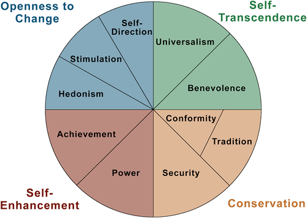{width=4.0in height=5.8in}

**Figure 1: Schwartz’s ten basic values on a circular continuum, grouped into four higher-order values. Adapted from [\[6\]](#ref-6).**

:::

Three strengths make the theory a suitable foundation. It has been tested across cultures, with studies covering 82 countries supporting its structure [\[6\]](#ref-6). It is established in large-scale practice: the European Social Survey has measured these values since 2002 [\[7\]](#ref-7). It is also the common framework for computational work on values, underpinning shared tasks on detecting human values in text [\[8\]](#ref-8) and benchmarks of the values expressed by large language models [\[9\]](#ref-9). Twinkl therefore builds on value definitions that are well studied and widely shared, not ones invented for the project.

Twinkl uses the original ten values, as a deliberate scoping choice for a proof of concept. Ten values match the established Best-Worst survey used for onboarding [\[10\]](#ref-10), and they keep the labelling task manageable for a corpus of this size, where most entries are already Neutral for any given value. Because the 19 refined values subdivide the original ten [\[5\]](#ref-5), a later version could adopt them without changing the underlying framework.

The theory describes what people value. It does not by itself show how to recognise value-consistent behaviour in personal writing, which is the problem Twinkl investigates.

## 2.2 AI-assisted Reflection {#ai-assisted-reflection .unnumbered}

Personal informatics research describes self-tracking as connected stages, from preparation and collection through to reflection and action [\[11\]](#ref-11). Later work shows that people do not move through these stages neatly; they lapse and resume, and their goals vary [\[12\]](#ref-12). A reflection tool therefore has to work across weeks of uneven writing, which motivates Twinkl's longitudinal design. Reflective informatics adds a view of what reflection itself involves, identifying breakdown, inquiry, and transformation as its key dimensions [\[1\]](#ref-1).

Recent work uses LLMs to make this kind of support more personal, by drawing on sensed behaviour to generate journaling prompts [\[13\]](#ref-13), inferring unstated preferences from conversation [\[14\]](#ref-14), or retrieving relevant moments from long-term memory [\[15\]](#ref-15). But adapting to the user is not the same as helping them reflect. Sycophancy research shows that an assistant can mirror a user's beliefs even when a more truthful response would disagree [\[2\]](#ref-2). In three preregistered experiments with 2,405 participants, Cheng et al. found that sycophantic AI increased participants' conviction that they were right and reduced their willingness to repair interpersonal conflict [\[16\]](#ref-16). Reflection support therefore needs observations grounded in evidence from the user's own writing, with interpretation and judgement left to the user.

Twinkl investigates this gap. It does not claim novelty for journaling, value profiling, long-term memory, or AI-generated reflection on their own. Its contribution is to connect them into an accountability path the user can inspect and contest: user-confirmed Core Values provide the reference, dated Journal Entries provide the evidence, Weekly Drift Detection decides whether the two have diverged, and the Coach Digest returns a cited, non-prescriptive reflection. In the terms of reflective informatics, this addresses breakdown and inquiry.

## 2.3 Synthetic data, LLM labels, and imbalanced ordinal targets {#synthetic-data-llm-labels-and-imbalanced-ordinal-targets .unnumbered}

Longitudinal personal journal data is difficult to obtain - real journals are private, require informed consent, and accumulate only over months. Twinkl therefore uses synthetic Journal Entries to train and evaluate models of value-behaviour alignment as synthetic-text methods have done for other NLP tasks [\[17\]](#ref-17). A longitudinal corpus also carries a requirement that single-entry datasets do not - variation across Personas must coexist with continuity within each Persona. Twinkl generates each Persona's Journal Entries in sequence, conditioned on that Persona's earlier Journal Entries. Demographic and narrative controls vary each Persona's age, profession, background and biography.

LLM-as-judge labelling methods add scalable supervision but can exhibit position, verbosity, and self-enhancement bias [\[18\]](#ref-18). Self-enhancement bias matters most for Twinkl, because we used Claude Code subagents both to write the Journal Entries and assigned their LLM-Judge VIF Labels. Errors from the generator and errors from the LLM-Judge may therefore be related. RQ1 describes the checks applied to these labels instead.

Labelling values in text is itself an established task. ValueEval asks which values an argument draws on, treating each value category as present or absent [\[8\]](#ref-8). Twinkl asks a different question: whether the behaviour described in a Journal Entry aligns with, conflicts with, or is neutral towards a value. Each LLM-Judge VIF Label is therefore ordinal, with -1 for Conflict, 0 for Neutral, and +1 for Alignment, and the distance between classes matters - predicting Alignment for a Conflict is a larger error than predicting Neutral. Quadratic Weighted Kappa (QWK) captures this by penalising larger disagreements more heavily [\[19\]](#ref-19), and ordinal methods such as CORAL build the class order into the model itself [\[20\]](#ref-20).

The labels are also heavily imbalanced. Majority of the labels are Neutral whereas Conflict, the class Drift depends on, is the rarest. A model can therefore reach high accuracy by predicting Neutral almost everywhere while missing most Conflicts. Balanced Softmax counters this by building class frequencies into the training objective [\[21\]](#ref-21), and Monte Carlo Dropout estimates the uncertainty of each prediction from repeated stochastic passes [\[22\]](#ref-22). Twinkl therefore reports QWK alongside Conflict recall and an uncertainty diagnostic rather than accuracy alone.

## 2.4 Sustained change in personal writing {#sustained-change-in-personal-writing .unnumbered}

Detecting change in personal writing over time is an established problem. Tsakalidis et al. introduced the task of identifying moments of change in users' online timelines, distinguishing sudden mood shifts from gradual escalations across 500 annotated timelines, and found that context-aware sequential models performed best [\[23\]](#ref-23). Twinkl asks a similar question with a different reference point: not whether someone's mood has changed, but whether their behaviour has moved away from the Core Values they confirmed. Any such alert has to decide how much evidence is enough. Alerting on a single Conflict would flag every bad day, waiting for more evidence means alerting later. Twinkl takes the simplest option as a proof of concept - one Conflict is treated as a possible bad day, and Drift is declared only after two Conflicts in a row for the same Core Value.

The Weekly Drift Reviewer should be able to say it cannot tell, rather than being forced to choose Conflict or Not Conflict. Selective classification supports this: a model that may skip uncertain cases answers fewer of them, but makes fewer errors on those it does answer [\[24\]](#ref-24). Twinkl's Weekly Drift Reviewer returns Abstain when a Journal Entry lacks evidence, and a failed review produces Insufficient Evidence rather than a guess.

## 2.5 Grounded reflection and evidence retrieval {#grounded-reflection-and-evidence-retrieval .unnumbered}

A reflection that cites the user's writing is only useful if the citation is faithful. Generated summaries often contain content their source does not support [\[25\]](#ref-25), evident from how the best systems evaluated by Gao et al. lacked complete citation support in half of answers on the 2023 ELI5 benchmark [\[26\]](#ref-26). Coach Digest Validations therefore check every quotation against the source text. Exact matching cannot catch a correct quotation used to support a wrong claim, however. FActScore checks generated text fact by fact. On generated biographies, the ChatGPT system evaluated by Min et al. achieved a FActScore of 58% [\[27\]](#ref-27), illustrating why supported facts need to be checked individually. Twinkl's six-response diagnostic found the same pattern in Coach Digest Evals (Section 4.4).

The North Star Moment adds a retrieval question. Retrieval-augmented generation conditions output on a few retrieved passages [\[28\]](#ref-28) but can miss evidence the retriever ranks poorly. Full histories avoid that risk but introduce another, since models use information at the start and end of a long input more reliably than information in the middle [\[29\]](#ref-29). Twinkl therefore compares Nomic top-three retrieval with the full eligible history directly (RQ4).

Motivational interviewing treats open questions as a core way to help people explore their own reasons for change without being told what to do [\[30\]](#ref-30). The Coach Digest follows this by avoiding prescriptive instructions and ending with one open question.

# 3. Methodology {#methodology .unnumbered}

This section describes the overall architecture and the method for each research question in turn: the synthetic corpus and its labels (RQ1), the VIF Critic (Offline) (RQ2), Weekly Drift Detection (RQ3), and the Coach Digest and the North Star Moment (RQ4). The results of each study are reported in the matching subsection of Section 4.

## 3.1 Overall Architecture {#overall-architecture .unnumbered}

::: {#source-fig-106 .source-figure source-number="2"}

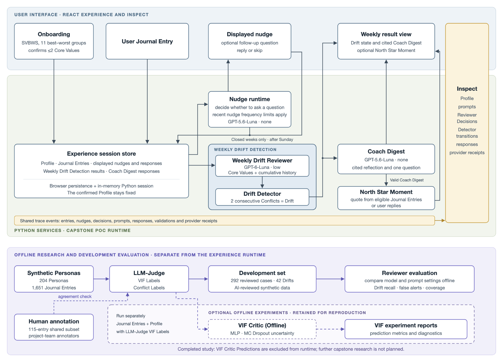{width=7.15in height=5.8in}

**Figure 2: Twinkl architecture. The user interface and runtime services form the online path; the offline research path produced the reference labels and the model comparisons. The VIF Critic (Offline) (dashed) has no connection to the runtime.**

:::

Figure [2](#fig-106) outlines Twinkl's architecture - an AI-assisted reflection application that compares a user's stated priorities over time, without prescribing how they should respond.

For the online path:

1.  Onboarding produces the user-confirmed Profile of Core Values

2.  Journal Entries, stored in date order with any nudge and reply, supply the longitudinal evidence.

3.  Within Weekly Drift Detection, the Weekly Drift Reviewer marks each Journal Entry Conflict, Not Conflict, or Abstain for each Core Value.

4.  The Drift Detector, a fixed rule, declares Drift only after two consecutive Conflicts for the same Core Value.

5.  The Coach Digest turns the result into a cited, non-prescriptive reflection.

6.  The North Star Moment retrieves and quotes a reported action that supports a Core Value. When Drift is active, that quotation comes from before Drift began.

7.  When a review fails or the evidence cannot support a claim, the application returns Insufficient Evidence rather than guessing

Figure 2 also shows a second, offline research path. Twinkl's initial design used synthetic data and trained a VIF Critic on the runtime path to route weekly reflection. However, model ablation experiments found that VIF Critic Predictions did not improve Drift recall, whether used as extra input to the Weekly Drift Reviewer or as a trigger for earlier review (Section 4.3.1). The adopted architecture therefore keeps the VIF Critic separate, with no arrow to Weekly Drift Detection.

The logical and physical architectures are shown in Figures [3](#fig-610) and [4](#fig-614), respectively.

::: {#source-fig-610 .source-figure source-number="3"}

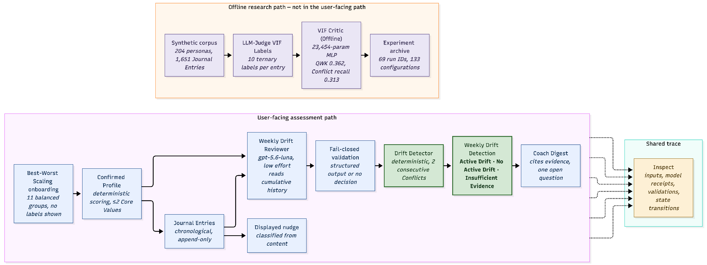{width=6.15in height=5.8in}

**Figure 3: Logical architecture snapshot with the earlier gpt-5.6-luna reviewer. The current Weekly Drift Reviewer uses gpt-6-luna at low reasoning effort.**

:::

::: {#source-fig-614 .source-figure source-number="4"}

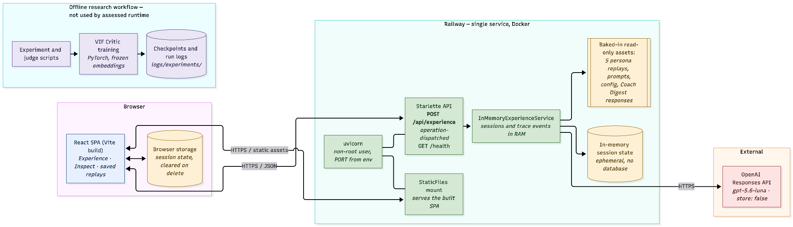{width=6.15in height=5.8in}

**Figure 4: Physical architecture snapshot with the earlier gpt-5.6-luna API label; current Weekly Drift Reviewer and North Star Moment selection use gpt-6-luna.**

:::

## 3.2 RQ1: Generating and validating a synthetic journal corpus {#rq1-generating-and-validating-a-synthetic-journal-corpus .unnumbered}

No public dataset follows the same people's journals over time and records which values their behaviour supports or works against. We therefore generated a synthetic corpus and subsequently evaluated whether it is suitable to develop and test the VIF Critic.

The final corpus contains 204 Personas, each with an age, profession, cultural background, biography and one or two Schwartz Core Values. For each Persona, a chronological sequence of 2-12 Journal Entries was generated, producing 1,651 in total. Every Journal Entry was generated from [a template](https://github.com/DesmondChoy/twinkl/blob/main/prompts/journal_entry.yaml) (prompts/journal_entry.yaml) conditioned on the Persona's biography, earlier Journal Entries, and a sampled tone, length and reflection mode (Unsettled, Grounded or Neutral), so that events and relationships could persist over time. The Persona and Journal Entry prompt templates, together with the full generation procedure, are available in the [project repository](http://github.com/DesmondChoy/twinkl/blob/main/docs/pipeline/claude_gen_instructions.md) (docs/pipeline/claude_gen_instructions.md).

To prevent the LLM-Judge and VIF Critic from relying on value keywords rather than described behaviour (e.g., predict Neutral or Alignment because of a phrase \"I value security\"), generation prompts barred 33 banned terms, including the ten Schwartz value names and their derivatives (e.g., \"ambitious\" and Achievement, \"kind-hearted\" and Benevolence). Generation parameters such as tone and reflection mode were also excluded from labelling and modelling, because real Journal Entries carry no such settings.

For each Journal Entry, the LLM-Judge assigned each of the ten values an LLM-Judge VIF Label of -1 (Conflict), 0 (Neutral, including insufficient evidence) or +1 (Alignment) with a rationale for each non-zero label. The LLM-Judge was able to see the Persona's earlier Journal Entries when labeling a later one.

### 3.2.1 Chronology: Synthetic Data Corpus Generation and Refinement: {#chronology-synthetic-data-corpus-generation-and-refinement .unnumbered}

::: {#source-tbl-119 .source-table source-number="2" column-widths="0.195556,0.397778,0.126667,0.133333,0.146667"}

**Table 2: Synthetic corpus generation phases.Targeted batches added Personas to the training split only, the validation and test Personas stayed fixed.**

| **Phase** | **Description** | **Personas** | **Journal Entries** | **Training Journal Entries (Cumulative)** |
| :--- | :--- | :--- | :--- | :--- |
| Base Corpus | Initial generation; generation settings and Core Value coverage adjusted | 180 | 1,460 | 1,022 |
| Targeted Batch 1 | Power and Security, training split only | 12 | 95 | 1,117 |
| Targeted Batch 2 | Hedonism and Security, training split only | 12 | 96 | 1,213 |
| Total |  | 204 | 1,651 | 1,213 |
| Base Corpus split by Persona |  |  |  |  |
| Training |  | 125 | 1,022 |  |
| Validation |  | 28 | 217 |  |
| Test |  | 27 | 221 |  |

:::

For the Base Corpus, each Persona received 2--12 Journal Entries. We iterated on the Journal Entry generation based on each round's findings, as seen in Section 4.1. At the end of this phase, the corpus was split by Persona into training, validation and test sets, where each split kept the overall share of +1 and -1 labels for every value.

### 3.2.2 Additional batch generations: {#additional-batch-generations .unnumbered}

During VIF Critic ablation experiments, the model performed poorly on certain Schwartz values, so we generated small targeted batches of Personas holding those values. Figure [5](#fig-124) illustrates how both batches followed the same five steps - Freeze, Generate, Verify, Label, Retrain.

::: {#source-fig-124 .source-figure source-number="5"}

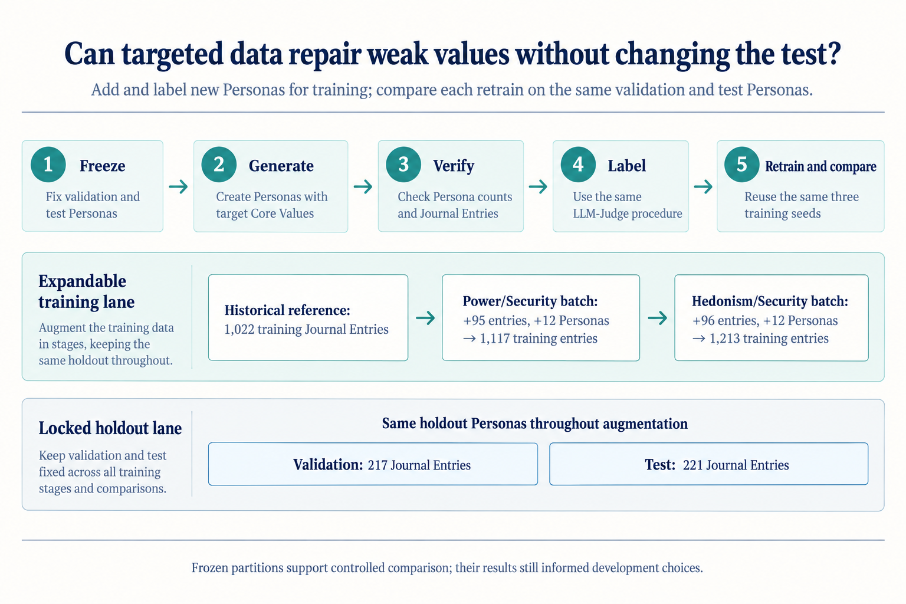{width=6.15in height=5.8in}

**Figure 5: Batch Generation of Synthetic Data. Training lane demonstrates the change in each batch, and locked holdout demonstrates the frozen Personas.**

:::

Targeted Batch 1 addressed the issue where VIF Critic often missed Power and Security Conflicts when they were small. For example, a Persona who stays silent while a colleague takes credit for their work is acting against Power, but nothing dramatic happens in the Journal Entry, so it is easy to read as Neutral. 12 Power and Security Personas (95 Journal Entries) built around small Conflicts were added.

Targeted Batch 2 was designed around VIF Critic's frequent misdiagnosis of Hedonism and Security when nuances appeared and added 12 Hedonism and Security Personas (96 Journal Entries). When a Persona rested or enjoyed something small, such as a quiet evening after a busy week, the VIF Critic often predicted a Hedonism Conflict, the opposite of the LLM-Judge's label. These Journal Entries often mentioned tiredness or guilt about resting, and the VIF Critic appeared to treat those negative feelings as a sign of Conflict. Similarly, when a Journal Entry used safety language (savings, safety, stability), but also expressed fear or uncertainty, the VIF Critic often predicted the wrong direction.

Table [3](#tbl-130) shows the resulting distribution. The 75.92% Neutral share makes the long-tail problem visible before model training.

::: {#source-tbl-130 .source-table source-number="3" column-widths="0.420575,0.288278,0.291146"}

**Table 3: Distribution recomputed from the persisted LLM-Judge VIF Labels in judge_labels.parquet (see Appendix A for the source path).**

| **LLM-Judge VIF Label** | **Count** | **Share** |
| :--- | :--- | :--- |
| Conflict (-1) | 1,165 | 7.06% |
| Neutral (0) | 12,535 | 75.92% |
| Alignment (+1) | 2,810 | 17.02% |
| **Total** | **16,510** | **100.00%** |

:::

In the synthetic corpus, each Persona's Core Values were assigned at generation. For a real user, Core Values come instead from the onboarding survey described in Section 3.6.1, which asks the user to choose the most and least important item in 11 sets of value statements. The synthetic corpus therefore assumes Core Values are already known, and it does not test how reliably onboarding identifies them.

### 3.2.3 Validating the LLM-Judge VIF Labels: {#validating-the-llm-judge-vif-labels .unnumbered}

Before using the LLM-Judge VIF Labels to train and test the VIF Critic, we checked two things:

- Do the LLM-Judge's labels agree with human judgement?

- Does the LLM-Judge give the same labels when asked again?

Judging values in journal writing is partly subjective, so even careful human annotators disagree. We therefore did not score the LLM-Judge against a single correct answer. Instead, we asked whether it agreed with each annotator as well as the annotators agreed with each other. We used kappa statistics, which correct for agreement expected by chance. This was important because most labels are Neutral: two annotators who labelled almost everything 0 would match most of the time without agreeing on anything meaningful.

- Fleiss' kappa: Handles more than two raters; measures agreement among the three human annotators and among the five LLM-Judge passes [\[31\]](#ref-31).

- Cohen's kappa: Measures agreement between the LLM-Judge and each annotator; we report the mean across the three annotators [\[32\]](#ref-32).

We interpreted the kappa values on the Landis and Koch scale [\[33\]](#ref-33) and set a target above 0.60 (\"substantial agreement\") for both measures. If human--human agreement fell below the target for a value, we read that as a sign that the value is ambiguous to judge from journal text, not only as a weakness of the LLM-Judge.

Agreement with human annotators. Three project members independently annotated 115 Journal Entries from 19 of the 204 Personas using an annotation tool as seen in Figure [6](#fig-141). These 19 Personas were selected to give a fair representation of all Schwartz values: each value was a Core Value for at least three Personas, except Stimulation, which had two. Annotators scored all ten values for each Journal Entry as −1, 0 or +1, the same scale the LLM-Judge used. They were given the same inputs as the LLM-Judge, and the LLM-Judge VIF Labels were revealed only after each annotator had saved their own. We set a target above 0.60 (\"substantial agreement\" on the Landis and Koch scale [\[33\]](#ref-33)) for both human--human and LLM-Judge--human agreement.

::: {#source-fig-141 .source-figure source-number="6"}

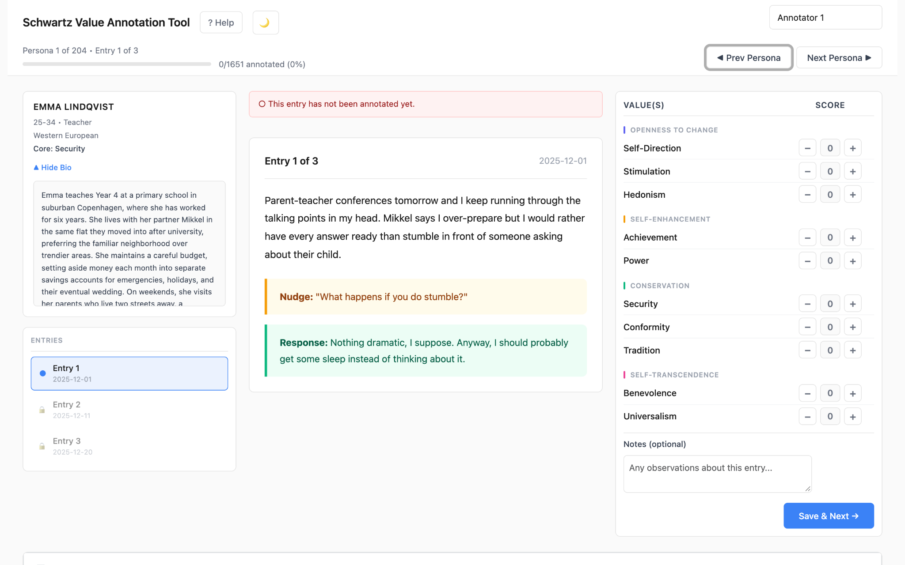{width=7.15in height=5.8in}

**Figure 6: The human annotation tool. Annotators see the Persona’s bio, the Journal Entry with any nudge and response, and score each Schwartz value as −1, 0 or +1, without seeing LLM-Judge VIF Labels.**

:::

Consistency across repeated runs. The LLM-Judge relabelled all 1,651 Journal Entries in five independent passes, and per-value Fleiss' kappa measured how often the passes agreed. We set a higher target (\>0.75) than for the human study because each pass used the same model, prompt and inputs, so disagreement reflects run-to-run randomness rather than differences in interpretation. Section 4.1 reports the results.

## 3.3 RQ2: Training a lightweight MLP to identify Alignment and Conflict {#rq2-training-a-lightweight-mlp-to-identify-alignment-and-conflict .unnumbered}

To support reflection, Twinkl needs to show users where their daily behaviour aligns with or works against their Core Values, which means assessing each Journal Entry against those values. We explore using a small multilayer perceptron (MLP) model, the Value Identity Function (VIF) Critic, trained on the LLM-Judge VIF Labels that can be used for this assessment. Because Conflict accounts for only 7.06% of those labels (Table [3](#tbl-130)), the main difficulty is recovering Conflict rather than achieving overall agreement.

### 3.3.1 Model Design: {#model-design .unnumbered}

The VIF Critic is an MLP with two hidden layers (64 units in the reference configuration) and a budget of about 23,000 trainable parameters. It receives two inputs:

- A Journal Entry embedding. A pretrained sentence encoder turns the current Journal Entry, including any nudge and response, into a fixed-length vector. The encoder stays frozen: its weights are not updated during training, so only the small MLP learns from the labels.

- A Core Value vector. Ten numbers, one per Schwartz value with weight split equally across the user's one or two Core Values and zero elsewhere

For each of the ten Schwartz values, the VIF Critic predicts one of three ordered classes: Conflict (−1), Neutral (0), or Alignment (+1). To estimate uncertainty, the VIF Critic uses Monte Carlo (MC) Dropout at prediction time: dropout stays switched on, and the model makes 50 predictions for the same input. The average of the 50 is the MC-mean prediction, and their spread is the uncertainty. The training pipeline and details are illustrated in Figure [7](#fig-149).

::: {#source-fig-149 .source-figure source-number="7"}

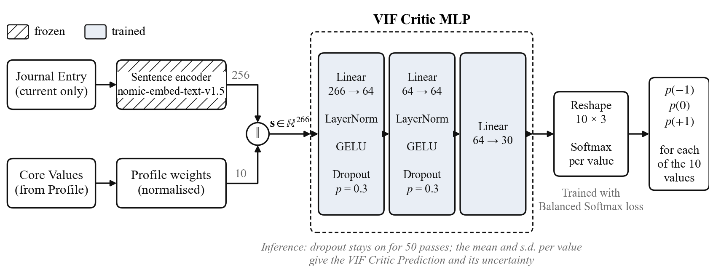{width=6.15in height=5.8in}

**Figure 7: VIF Critic MLP**

:::

### 3.3.2 Training protocol: {#training-protocol .unnumbered}

All comparisons reported in this section use the same Persona-level split, so no Persona appears in more than one partition. Early exploratory runs used a smaller, earlier version of this split and informed only initial design choices, such as the choice of encoder and the decision to read one Journal Entry at a time. The validation and test partitions were then frozen. The training partition grew from 1,022 to 1,213 Journal Entries with the targeted batches (Section 3.2.1). To isolate each factor, all runs shared the same training settings: dropout of 0.3, weight decay of 0.01, batch size 16, a learning rate of 0.015522, up to 100 epochs and early-stopping patience of 20. The only exceptions were some early ordinal-loss runs, which used different learning rates.

### 3.3.3 Evaluation protocol: {#evaluation-protocol .unnumbered}

We judged how well the model works in two ways:

- Against the LLM-Judge VIF Labels, which serve as the reference answers. (RQ1 discusses how reliable/trustworthy these labels are)

- Against two LLMs (gpt-5.4-mini and gpt-5.4-nano), given the same input on the same test set. This shows how much is lost by using a small model instead of an LLM.

Several metrics are used to evaluate the model. Each metric is calculated separately for each of the ten values. The per-value scores are then aggregated with equal weights. Because a high QWK can hide weak Conflict detection, we report class-specific measures alongside it.

- QWK. Measures overall agreement with the LLM-Judge VIF Labels across all three classes. Because Conflict makes up only 7% of labels, a model can miss most Conflicts and still reach a reasonable QWK.

- Conflict recall. For each Schwartz value, the proportion of reference -1 labels that the VIF Critic also predicts as -1.

- Minority recall (Average recall for -1 and +1). Used to indicate whether the model defaults to Neutral.

- Hedging (Share of predictions between −0.3 and +0.3). It shows how often the model avoids committing to a direction and predicts Neutral.

- Error-uncertainty correlation. The Spearman rank correlation between absolute prediction error and MC Dropout uncertainty. A larger positive value means that larger errors tend to receive higher uncertainty, so it shows whether the model's uncertainty can be trusted.

These measures were used at three points in the process, each with a different role.

1.  Choosing a checkpoint within a training run. The model is saved at many points during training, and one of these checkpoints is selected using the validation set. Within each training run, the checkpoint with the highest validation QWK was chosen, with Conflict recall, the error-uncertainty correlation and hedging used in that order to break ties.

2.  Deciding whether an alternative setup should replace the reference model. Here each setup was trained with three random seeds and compared on the test set using the median of the three runs.

3.  Describing the chosen model. Per-value results, hedging, uncertainty and the diagnostic tests show what the model can and cannot do without being used to choose between models.

### 3.3.4 Ablation Design: {#ablation-design .unnumbered}

The VIF Critic was developed through a staged ablation of 69 run IDs and 133 persisted configurations. Because each training seed has its own run ID and many configurations share data, architecture, or selection decisions, we compare them by factor.

- Text Representation - Does a different embedding model capture more value signal?

- Loss & Objective - Does a different training objective recover more Conflict labels?

- Training Data - Does targeted data augmentation help the weakest values?

- Labels & Context - Do the labels and historical context limit what the models can learn?

Text Representation. Nomic Embed provides the training background for the encoder family [\[34\]](#ref-34); the official nomic-embed-text-v1.5 model card documents its 768-dimensional embeddings and Matryoshka dimensional reduction [\[35\]](#ref-35). The initial comparison set all-MiniLM-L6-v2, which read three Journal Entries, against nomic-embed-text-v1.5, which read only the current one. Later comparisons kept the parameter budget near 23,000 by truncating each alternative encoder to 256 dimensions. The full 768-dimensional Nomic embedding was tested twice: once within the same budget, with the hidden layers narrowed to 28 units, and once with 64-unit hidden layers.

Loss. Ordinal losses use the order of the three classes, so that predicting Alignment for a Conflict costs more than predicting Neutral. Balanced Softmax and LDAM-DRW instead correct for how rare each class is. Two additions to Balanced Softmax were also tested: per-value loss weighting, which reweights the ten values during training according to a smoothed record of each value's loss, and a circumplex regulariser, which discourages predicting the same direction for values that oppose each other on the Schwartz circle. The two-stage model is a single network with two output heads - it first predicts whether a Journal Entry shows any evidence for a value (activation), then whether that evidence aligns or conflicts (polarity).

Training data. See Section 3.2.2.

Labels. The LLM-Judge assigned the original labels with more information than the VIF Critic receives, including the Persona's biography and earlier Journal Entries. For example, it labelled a Journal Entry as a Security Conflict in which a young artist defends her career choice, because she \"continues to choose an unpredictable artistic career\"; that judgement draws on her biography. We therefore relabelled Security for all 1,651 Journal Entries using only the VIF Critic's input. Each Journal Entry received three gpt-5.4-mini reviews decided by majority, with a fourth review for 25 ties. This changed 678 labels (41.1%), mostly from Neutral to Alignment or Conflict. Consensus labels and soft vote-distribution targets instead drew on the five repeated LLM-Judge passes (Section 3.2.3), using the majority vote or the share of votes for each class.

Context. To test whether the model needs earlier Journal Entries, we appended a 64-dimensional summary of up to three earlier Journal Entry embeddings, together with a count of how many were available, and kept everything else fixed.

### 3.3.5 Comparison with an LLM given the same input: {#comparison-with-an-llm-given-the-same-input .unnumbered}

To show what is lost by using a small model instead of an LLM, we gave two LLMs, gpt-5.4-mini and gpt-5.4-nano, the same input as the VIF Critic: the current Journal Entry, including any nudge and response, and the user's Core Values. Neither model received examples or used extended reasoning. Each returned a Conflict, Neutral or Alignment label for all ten values. Each LLM was run once on the same 221-Journal Entry test set and scored with the same metrics as the VIF Critic. Section 4.2.5 reports per-value medians over seeds 11, 22 and 33, lists the reference median and seed-22 aggregate separately, and reports seed-22 per-value QWK.

## 3.4 RQ3: Detecting Drift over time with an LLM reviewer {#rq3-detecting-drift-over-time-with-an-llm-reviewer .unnumbered}

### 3.4.1 Weekly Drift Reviewer and Drift Detector: {#weekly-drift-reviewer-and-drift-detector .unnumbered}

As the lightweight VIF Critic was found to be unsuitable for detecting Conflict consistently (Section 4.2), we replaced it with an LLM--based Weekly Drift Reviewer.

Weekly Drift Reviewer. While the VIF Critic predicted ordinal scores per values per Journal Entry with Conflict inferred from a -1 (Conflict) score, the Weekly Drift Reviewer receives the Persona's cumulative Journal Entry history up to the weekly cutoff, together with the Persona's Core Values. For each Journal Entry written that week and each Core Value, it returns one Weekly Drift Reviewer Decision: Conflict, Not Conflict, or Abstain. It receives no generation or labelling metadata from the synthetic corpus.

Drift Detector. After the reviewer has assigned each Journal Entry decision, a separate deterministic rule, the Drift Detector, counts each uninterrupted run of at least two consecutive Conflicts for the same Core Value as one Drift. Figure [8](#fig-176) below illustrates how the Drift Detector decides if there has been a Drift.

::: {#source-fig-176 .source-figure source-number="8"}

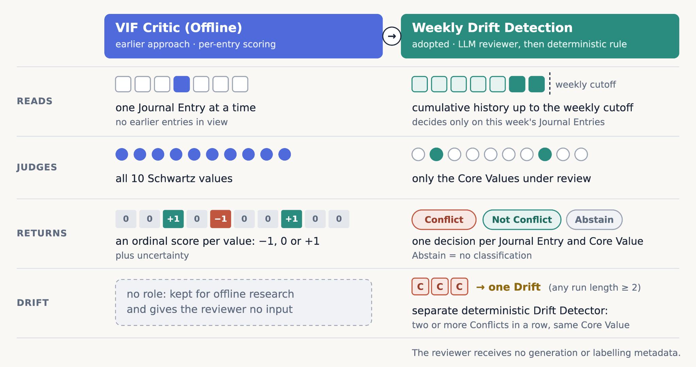{width=6.15in height=5.8in}

**Figure 8: Evolution of VIF Critic to the Weekly Drift Detection.**

:::

Several Weekly Drift Reviewer setups were tested during development. The current live contract uses gpt-6-luna at low reasoning effort. We summarised the number of Conflict patterns detected across our dataset in the table below.

The two-Conflict rule comes from an exploratory analysis of LLM-Judge VIF Labels. Single Conflicts were common but mostly short-lived: 84.4% of changes into Conflict on a Core Value returned to 0 or +1 within two Journal Entries. Two consecutive Conflicts was therefore selected as a Drift as it's indicative of a repeated pattern.

::: {#source-tbl-180 .source-table source-number="4" column-widths="0.398058,0.417476,0.184466"}

**Table 4: Distribution of Conflict runs in the LLM-Judge VIF Labels for Core Values**

| **Conflict pattern** | **Core Value trajectories** | **Personas** |
| :--- | :--- | :--- |
| Any transition into −1 | 102 / 292 | 92 / 204 |
| 2 consecutive -1 | 41 / 292 | 40 / 204 |
| 3 consecutive -1 | 20 / 292 | 20 / 204 |
| 4 consecutive -1 | 5 / 292 | --- |

:::

Figure [9](#fig-185) illustrates the Drift state diagram.

- A first valid Conflict starts a run while the current state remains No Active Drift.

- A second adjacent valid Conflict creates Active Drift.

- A failed review always produces Insufficient Evidence.

- A valid Abstain or Journal Entry gap produces Insufficient Evidence only if it interrupts a Conflict run or leaves an existing Drift state unresolved.

- An isolated Abstain with no recent Conflict evidence leaves the state at No Active Drift. Historical Drift Records remain stored and unaffected by future state changes.

::: {#source-fig-185 .source-figure source-number="9"}

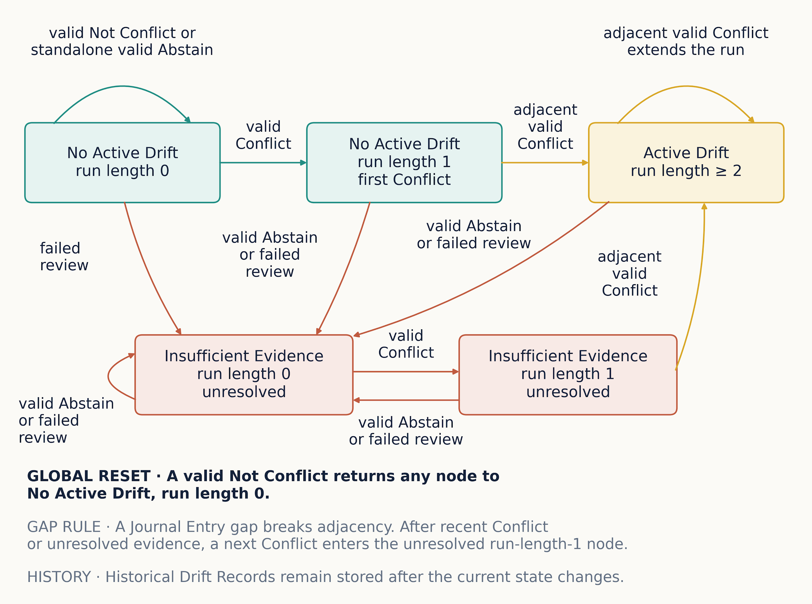{width=5.844in height=5.8in}

**Figure 9: Drift State Diagram. The 5 nodes distinguish the current state and run-length or resolution status, while edges illustrate required conditions.**

:::

### 3.4.2 Development dataset: {#development-dataset .unnumbered}

::: {#source-fig-189 .source-figure source-number="10"}

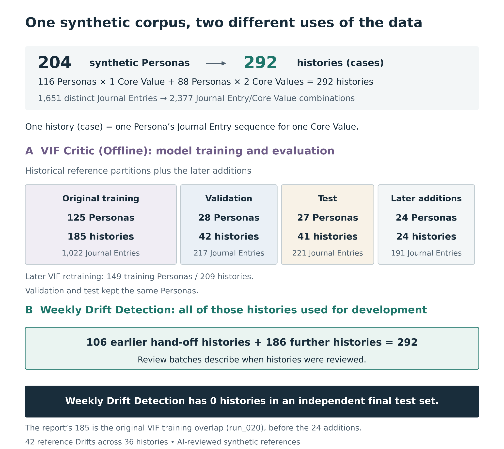{width=6.15in height=5.8in}

**Figure 10: Multiple uses of the same synthetic data**

:::

Persona/Core Value histories. All Weekly Drift Detection results use the full synthetic corpus of 204 Personas as a development set: every setup was chosen by looking at results on this data, and no separate final test set was used. Each history is one Persona's sequence of Journal Entries, read against one Core Value. Because 88 Personas declared two Core Values and 116 declared one, the set contains 292 Persona/Core Value histories, each with a final Drift reference outcome. The 292 Persona/Core Value histories contain 2,377 Journal Entry/Core Value combinations and 42 reference Drifts across 36 histories.

**Reference labels and Drift**

::: {#source-tbl-193 .source-table source-number="5" column-widths="0.338496,0.331858,0.329646"}

**Table 5: Reference labels and Weekly Drift Reviewer Decisions**

| **Reference labels or reviewer decisions** | **LLM Model** | **How output is produced** |
| :--- | :--- | :--- |
| **LLM-Judge Conflict Labels (AI-reviewed reference)** | (gpt-5.6-sol at xhigh reasoning effort) | Two independent reviews, then a third review wherever they disagreed |
| **Weekly Drift Reviewer Decisions** | model and reasoning effort vary by experiment setup (gpt-5.4-mini, gpt-5.6-luna, gpt-6-luna) | One call per Persona-week, as the product would run it |

:::

Each Journal Entry/Core Value pair received an LLM-Judge Conflict Label of Conflict, Not Conflict or Uncertain, based on the behaviour the Journal Entry shows. Each label came from two independent LLM-Judge reviews. Where the reviews disagreed, a third review settled the label. For the 186 histories outside the VIF Critic support study sample, the two reviews agreed on 1,412 of 1,483 decisions (95.2%). However, they initially identified 32 and 85 decisions as Conflicts respectively, showing that high overall agreement coexisted with different rates of identifying the rare Conflict class. A disagreement-only review resolved the remaining 71 decisions. Applying the Drift Detector rule to these labels gives 42 reference Drifts across 36 of the 292 histories.

### 3.4.3 Evaluation metrics: {#evaluation-metrics .unnumbered}

We used the following metrics to evaluate Weekly Drift Detection against reference Drifts derived from the AI-reviewed LLM-Judge Conflict Labels:

- Drift recall: Proportion of reference Drifts matched by a predicted Drift

- Drift precision: Proportion of predicted Drifts matched to a reference Drift

- False Drift alert: When there is an unmatched predicted Drifts

- Detection delay: Number of calendar days between reference confirmation date and the matched prediction's alert date

- Coverage: Measured over Persona/Core Value pairs, where a history is covered when the returned decisions establish an adjacent pair of Conflicts, or when every observed adjacent Journal Entry pair contains a definite Not Conflict decision that rules out such a pair.

A predicted Drift matches a reference Drift if:

::: {#source-fig-200 .source-figure source-number="11"}

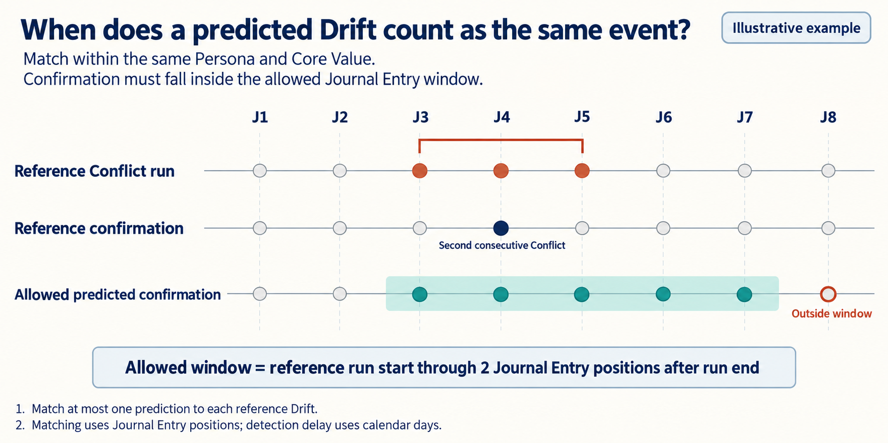{width=5.688in height=5.8in}

**Figure 11: Predicted Drift matching logic**

:::

Figure [11](#fig-200) illustrates how a predicted Drift matches a reference Drift derived from LLM-Judge Conflict Labels.

- Predicted and reference Drifts match one-to-one within the same Persona and Core Value

- The predicted Drift's confirmation position falls between the first Conflict in the reference run and two Journal Entry positions after the last Conflict marker

::: {#source-tbl-204 .source-table source-number="6" column-widths="0.150110,0.094923,0.092715,0.092715,0.092715,0.185430,0.291391"}

**Table 6: Sample Conflict detection patterns and Drift results. The Reasoning column explains each Drift result.Each complete-development Weekly Drift Reviewer setup used 951 Persona-week prompts across 204 Personas and three repeats.**

|  | **J1** | **J2** | **J3** | **J4** | **Result** | **Reasoning** |
| :--- | :--- | :--- | :--- | :--- | :--- | :--- |
| A | C | N | N | C | **No Drift** | J1 and J4 are Conflicts, but not consecutive |
| B | N | C | C | N | **Drift** | Two Conflicts in a row |
| C | C | C | C | C | **Drift** | A longer run still counts once |
| D | C | A | C | N | **No Drift** | The Abstain breaks the run; the state is Insufficient Evidence until the gap is resolved |
| E | C  (Benevo­lence) | C (Achieve­ment) |  |  | **No Drift** | The two Conflicts must be on the same Core Value |

:::

### 3.4.4 Study designs: {#study-designs .unnumbered}

Section 4.2 shows that the VIF Critic does not detect Conflict reliably enough to be used on its own. We therefore ran three studies on the Weekly Drift Reviewer:

::: {#source-tbl-208 .source-table source-number="7" column-widths="0.257576,0.391775,0.194805,0.155844"}

**Table 7: Study design questions and data**

| **Study** | **Question** | **Held fixed** | **Data** |
| :--- | :--- | :--- | :--- |
| **VIF Critic hand-off** | Does adding VIF Critic Predictions improve the Weekly Drift Reviewer? | gpt-5.4-mini, no reasoning effort | 106 histories, 33 reference Drifts |
| **Weekly Drift Reviewer model and reasoning-effort studies** | Which model and reasoning effort should the Weekly Drift Reviewer use? | Prompt version within each step; no VIF Critic input | 292 histories, 42 reference Drifts |
| **Effect of Core Value definitions on Drift detection** | Does adding Core Value definitions change which Drifts are detected? | gpt-5.6-luna, low reasoning effort | 292 histories |

:::

Every setup ran three times, because the Weekly Drift Reviewer's decisions vary between runs. The first two studies compare setups against reference Drifts using the metrics in Section 3.4.3. Their paired 95% intervals come from 10,000 bootstrap samples of whole Persona/Core Value histories. Whole histories are resampled because a Drift spans consecutive Journal Entries. Within each sample, the paired difference is computed for each of the three runs and the median is taken. Seeds are recorded in the project repository.

VIF Critic hand-off. A model that falls short alone may still help in combination: its predictions could give the Weekly Drift Reviewer extra evidence, or signal when an early review is worthwhile. Before the original gpt-5.6-luna low contract was adopted, this study tested three setups with gpt-5.4-mini at no reasoning effort. It used a frozen sample of 106 histories containing 33 known Drifts:

- Weekly Drift Reviewer without VIF Critic input;

- Weekly Drift Reviewer with raw VIF Critic Predictions;

- VIF-Critic-triggered early Weekly Drift Reviewer calls, triggered when two consecutive Journal Entries had mean predicted P(−1) $\geq$ 0.8 and maximum uncertainty $\leq$ 1.010153, plus Weekly Drift Detection.

Only the VIF Critic input or schedule changed between setups. Section 4.3.1 reports the results.

Weekly Drift Reviewer model and reasoning-effort studies. The model and reasoning-effort studies ran in four steps, all on the full development set. OpenAI documents the available GPT-5.6 Luna reasoning-effort settings [\[36\]](#ref-36); the saved requests in Appendix A record the settings used here:

1.  Model comparison. gpt-5.4-mini-2026-03-17 was compared with gpt-5.6-luna, both at no reasoning effort.

2.  None versus low reasoning effort. A preregistered rule would adopt low only if coverage fell by no more than 0.05. Low failed this rule. After seeing the results, the project replaced the rule with a ranking of Drift recall first and false Drift alerts second, with coverage as a diagnostic, and adopted low. This setup is the original gpt-5.6-luna low contract. Because the rule changed after the results were known, it is a documented choice rather than a preregistered optimum.

3.  Higher reasoning effort. Medium, high and xhigh were each compared against low, and low was retained.

4.  Model update. gpt-6-luna and gpt-5.6-luna were compared at none and low reasoning effort on the same 951 requests per repeat. This comparison led to the current live contract.

Results from step 4 are not directly comparable with steps 1--3 because the prompt version differs. Steps 1-3 used prompt v0, whereas step 4 used v2, and the prompt versions are explained in the next section.

**Prompt Evolution**

The initial prompt (v0) asked the model to assess current-week Journal Entries against declared Core Values using cumulative history, counting only clear behavior or choices as Conflict, and cite exact text. The prompt-alignment study then tested a possible improvement, by providing pairs of consecutive Journal Entries, a Core Value rubric, and requesting an explicit Drift decision. These changes addressed differences between the Weekly Drift Reviewer's input and the reference-label review. They were not adopted: median Drift recall fell from 0.40 to 0.20 and median false Drift alerts rose from one to five

The next iteration of the prompt (v1) tightened the evidence rules after the earlier study. Conflict required a direct behavior or choice with at least medium confidence; low-confidence cases became Abstain; and Not Conflict could not be treated as proof of improvement. Its effect was not measured separately against the initial version.

The final iteration (v2) addressed a different gap: the previous version supplied Core Value names without their explanatory context, so we added each selected value's existing definition and core motivation. A control between this version and the last comparison found changes in detected Drift counts, but did not establish an accuracy gain. Later gpt-5.6-luna and gpt-6-luna comparisons held the final prompt fixed; their results therefore measure model differences under that prompt, not the benefit of a prompt revision.

**Effect of Core Value definitions on Drift detection**

This study compared prompt v1 with v2. v1 adds confidence, reason and exact-quote rules to v0 and names the Core Values under review. v2 also gives each Core Value's definition and motivation. Both used gpt-5.6-luna at low reasoning effort on the complete development set, with three runs each, for 5,706 requests sent in random order.

## 3.5 RQ4: Preserving and retrieving the user’s words (Coach Digest & North Star Moment) {#rq4-preserving-and-retrieving-the-users-words-coach-digest-north-star-moment .unnumbered}

Two components of the application quote the user's own writing. The Coach Digest reflects on the reviewed week, while the North Star Moment selects a quotation of a reported action supporting a confirmed Core Value from an eligible Journal Entry.

### 3.5.1 Coach Digest: {#coach-digest .unnumbered}

This uses the stored Weekly Drift Detection result and cited Journal Entries to offer an evidence-based reflection summary and a question for the user. The generation uses complete displayed text for the selected Journal Entries, including nudges, responses, and Drift states. It must cite relevant Journal Entry text, avoid prescriptive instructions and unsupported claims, and ask one open question.

When the evidence is inconclusive, the Coach Digest may express that uncertainty through a grounded, open question rather than an explicit statement about insufficient evidence. It does not independently determine whether Drift exists.

Evaluation. Coach Digest Validations check every extracted quotation against the supplied evidence and screen for unsupported state claims, technical jargon, excessive length, and specified language problems. New ordinary responses also require an exact weekly quotation in the opening field, three nonempty fields, and one question, with a 180-word maximum and no minimum; saved responses retain their versioned validation rules. These checks can verify quotation matches and question form, but assessing source interpretation and whether a question is open, relevant, and non-prescriptive requires semantic review.

We used three complementary methods to evaluate the Coach Digest.

1.  Coach Digest Validations checked observable requirements such as quotation grounding, prohibited terminology, unsupported state claims, response length, and the format of the reflective question.

2.  Coach Digest Evals used an AI evaluator to assess correctness (accurate reflection), specificity (concrete details), non-prescriptive tone (avoid commands or moral judgment), tension honesty (avoid unsupported claims), each on a scale of 1-5.

3.  Targeted source review compared generated interpretations directly with the completed Journal Entries to identify chronology, attribution, and causal errors that the others could miss.

### 3.5.2 North Star Moment (NSM): {#north-star-moment-nsm .unnumbered}

Selection rules. NSM is implemented to quote a reported action supporting a confirmed Core Value after each eligible closed week.

The week's Drift result decides which moment is shown.

- If the state is Active Drift, the quotation comes from before the Drift began, reminding the user how they acted when they were still living out the Core Value.

- If the state is No Active Drift, Twinkl prefers an action from the week just reviewed, as encouragement, and otherwise uses an older example framed as a reminder.

- If the state is Insufficient Evidence, no quotation is shown.

Inspection. Figure [12](#fig-237) shows the recorded assessment of one selected source. Inspect exposes the reported action, its relation to the Core Value, and whether the source also contains opposing behaviour, allowing the quotation to be examined alongside the basis for its selection.

::: {#source-fig-237 .source-figure source-number="12"}

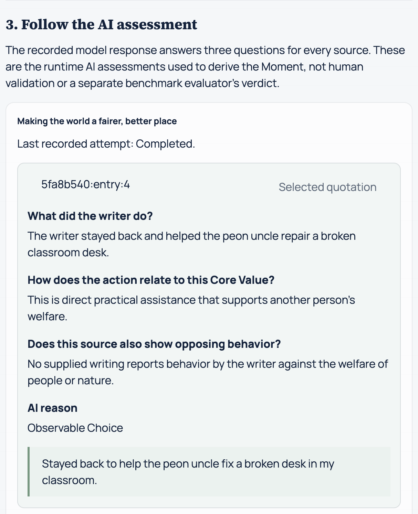{width=3.875in height=5.8in}

**Figure 12: Inspect’s recorded source assessment for Nisha’s fourth-week North Star Moment. The selected quotation describes an action before Drift onset. This saved synthetic replay illustrates the inspection process; the assessment is AI-generated.**

:::

Experiment design and metrics. The NSM experiment compared two ways of finding the quotation.

1.  Nomic top three: Retrieve the three most relevant Journal Entries with Nomic embeddings and ask gpt-5.6-luna, at low reasoning effort, to choose among them.

2.  Full eligible history: Give the same model the user's full eligible history.

Both methods ran on 501 closed weeks from 105 synthetic Personas, split by Persona into 81 development and 24 qualified-final Personas. A shared evaluator, gpt-5.6-luna at xhigh reasoning effort, independently reviewed each history and each selected quotation. The live application now uses gpt-6-luna.

We used the following metrics to evaluate NSM performance:

- Card precision: the share of scored displayed cards that were correct.

- Opportunity recall: the share of weeks with a suitable quotation available that received a correct card.

We compared the methods using the difference in each metric, with 95% intervals from 10,000 bootstrap resamples of whole Personas, because weeks from the same Persona are not independent.

## 3.6 Application Foundations {#application-foundations .unnumbered}

The research questions rely on three parts of the online path in Figure [2](#fig-106):

- Onboarding sets the Core Values that each Journal Entry is reviewed against (3.6.1)

- Journal Entries and nudges supply the text that the Weekly Drift Reviewer reads (3.6.2)

- Inspect traces each displayed result back to the rule or model call that produced it (3.6.3)

### 3.6.1 User Onboarding: {#user-onboarding .unnumbered}

Onboarding produces the Profile against which every later Journal Entry is reviewed, so the elicitation method shapes what Weekly Drift Detection can detect. Rating scales are poorly suited to this task. When people rate values independently, they tend to mark most of them as important, and the resulting ceiling leaves little to separate a first priority from a fifth [\[10\]](#ref-10).

Twinkl therefore uses Best-Worst Scaling, which asks the user to choose the most and least important item from a small set. Each choice is a forced trade-off, so a user cannot report every value as equally important, and the Most and Least counts place all values on one relative scale [\[10\]](#ref-10), [\[37\]](#ref-37).

The UI adapts the balanced design published by Lee et al. [\[10\]](#ref-10). Universalism is presented as two separate concerns, for nature and for other people, which gives 11 value objects. These are arranged into 11 groups of six, so every object appears six times and every pair of objects appears together three times. The application randomises group and card order and presents one group at a time without Schwartz labels or scores (Figure [13](#fig-252)). In each group the user selects one Most and one Least object, for 22 recorded choices in total.

::: {#source-fig-252 .source-figure source-number="13"}

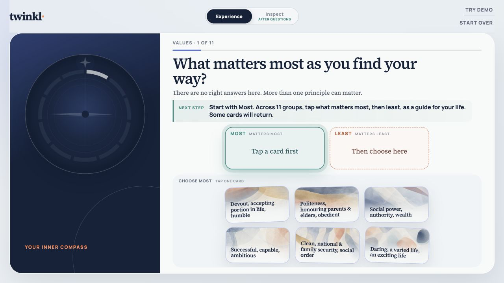{width=6.15in height=5.8in}

**Figure 13: One onboarding group presents six selection cards and requires separate Most and Least choices without exposing Schwartz labels or scores.**

:::

For each value object $i$, the raw Best-Worst Scaling score is

$$s_i=(B_i-W_i)/6,\qquad -1\leq s_i\leq1.\tag{1}$$

where $B_i$ and $W_i$ are the Most and Least counts. For Universalism, Twinkl takes the mean of the two facet scores.

The ten scores are then normalised into display weights that keep the ranking but not the ratios. The display weight for each Schwartz value $i$ is defined as

$$w_i=\frac{s_i-\min_{j=1,\ldots,10}s_j+1}{\sum_{k=1}^{10}\left(s_k-\min_{j=1,\ldots,10}s_j+1\right)},\qquad i=1,\ldots,10.\tag{2}$$

It subtracts the lowest of the ten scores from every score, adds one, and normalises the ten shifted scores to sum to one. This transformation preserves score ordering but a weight twice as large does not mean that the value is twice as important.

The highest-scoring value(s) are shown for confirmation (Table [8](#tbl-263)). If more than two values tie at the top, the user must select exactly two. A confirmed Profile therefore has at most two Core Values. We cap the Profile at two because every Persona used for development has one or two Core Values (Section 3.2), so evaluation results do not cover larger profiles. The cap also keeps a tie from producing an unbounded Profile. Because Schwartz's theory gives no rule for breaking exact ties, the user, not Twinkl, chooses which two values come first.

::: {#source-tbl-263 .source-table source-number="8" column-widths="0.166667,0.097778,0.082222,0.082222,0.091111,0.480000"}

**Table 8: Calculation of a user’s Core Values from one completed onboarding questionnaire: Most and Least counts, raw score (Equation (1)), display weight (Equation (2)) and the phrase shown in the user interface.**

| **Schwartz value** | **Most** | **Least** | **Score** | **Weight** | **Shown in User Interface** |
| :--- | :--- | :--- | :--- | :--- | :--- |
| **Benevolence** | 6 | 0 | +1.00 | 17.7% | Being there for the people closest to me |
| **Universalism** | See note |  | +0.17 | 11.4% | Making the world a fairer, better place |
| **Stimulation** | 1 | 0 | +0.17 | 11.4% | Seeking new experiences and challenges |
| **Achievement** | 1 | 1 | 0.00 | 10.1% | Making progress towards something meaningful |
| **Self-Direction** | 0 | 1 | -0.17 | 8.9% | Having the freedom to choose my own path |
| **Power** | 1 | 2 | -0.17 | 8.9% | Having influence over how things go |
| **Conformity** | 0 | 1 | -0.17 | 8.9% | Being someone others can count on to do the right thing |
| **Hedonism** | 0 | 2 | -0.33 | 7.6% | Enjoying life and having fun |
| **Security** | 0 | 2 | -0.33 | 7.6% | Feeling calm and secure in my life |
| **Tradition** | 0 | 2 | -0.33 | 7.6% | Honoring the customs and practices I was raised with |

:::

*Note: the Universalism score is the mean of its Nature (+0.17) and Social (+0.17) facet scores. Weights are rounded to one decimal place. The phrases are the exact interface text.*

### 3.6.2 Journal Entries and Contextual Nudges: {#journal-entries-and-contextual-nudges .unnumbered}

After confirming a Profile, the user records dated Journal Entries in the Experience. Saving an entry does not trigger a review. Weekly Drift Detection runs only when the user closes a completed Monday-to-Sunday week.

::: {#source-fig-269 .source-figure source-number="14"}

::: {.source-panel}
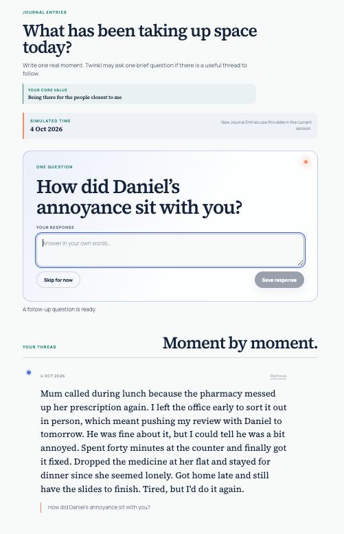{width=100% height=4.8in}\
*(a) User experience of entering a Journal Entry and receiving a nudge*
:::

::: {.source-panel}
*(b) Weekly result view after the week closes: Active Drift for one Core Value, the Journal Entries behind the Drift, the Coach Digest and a North Star Moment*\
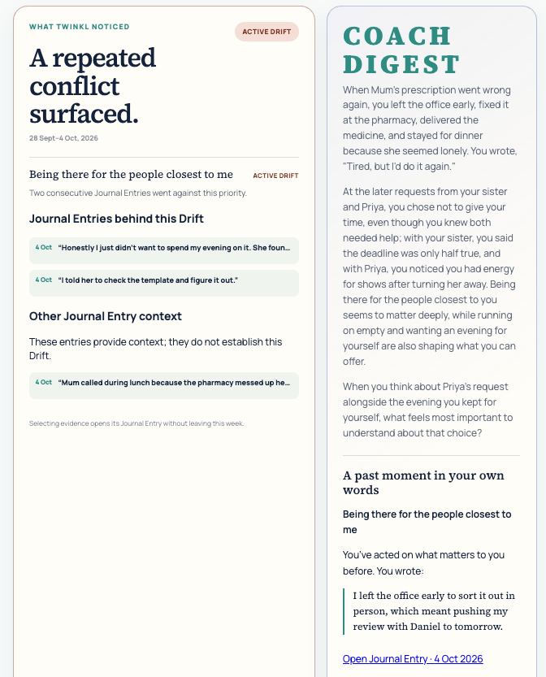{width=100% height=4.8in}
:::

**Figure 14: Journal Entry and weekly result screens in the user interface**

:::

After a Journal Entry is saved, Twinkl may ask one brief contextual question ("nudge") to encourage further reflection, as seen in Figure [14](#fig-269). The nudge is classified as clarification, elaboration, or tension-surfacing and is generated from the user's current and recent writing.

- Clarification Nudge - Triggered when an entry is too ambiguous to score meaningfully --- prompts the user to add context before the system interprets

- Elaboration Nudge - Triggered when an entry is too surface-level --- invites deeper reflection on what the user is actually weighing

- Tension Surfacing Nudge - Triggered when the system detects signals of internal conflict --- names the tension explicitly so the user can engage with it

Users may answer or skip it, and an anti-annoyance rule limits how frequently nudges appear, and no nudge is offered if two of the previous three entries already received one. The displayed nudge and response are stored with the entry, and the Weekly Drift Reviewer reads them together, so a nudge can supply evidence that the original entry lacked. Synthetic Journal Entries used the same nudge types and frequency rule, and Personas answered with probability 0.7, so LLM-Judge VIF Labels, VIF Critic inputs and Weekly Drift Reviewer evaluation all use the full entry, nudge and reply. Figure [14](#fig-269) illustrates an example of the weekly result, including the Drift Detector state, Coach Digest and North Star Moment.

### 3.6.3 Inspect: Explainable AI via prompt and decision telemetry: {#inspect-explainable-ai-via-prompt-and-decision-telemetry .unnumbered}

In addition to the user-facing view, we added an Inspect view to allow an assessor to examine how a displayed result was produced. Switching between the two views neither repeats a model call nor changes the session.

Inspect opens on a focused summary of how the selected result was reached (Figure [15](#fig-277)). It lists the Weekly Drift Reviewer Decisions, the Drift Detector result, the Coach Digest, and any North Star Moment. Below it sits the complete event timeline, which can be filtered to Journal Entries, the Weekly Drift Reviewer, or weekly results. Each event expands to show its inputs, prompts, responses, and validation, with identifiers and hashes under Technical details. Key events also link to the method and the code that implements it.

::: {#source-fig-277 .source-figure source-number="15"}

::: {.source-panel}
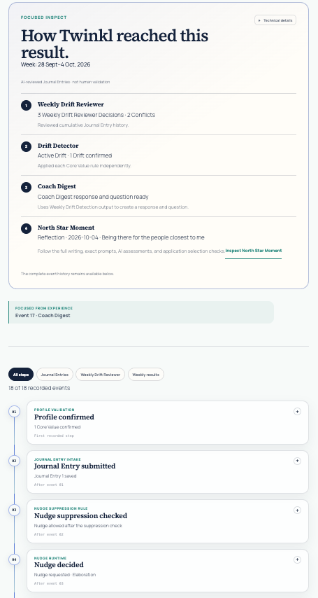{width=100% height=4.8in}\
*(a) Inspect summary of how the Weekly Drift Reviewer Decisions, Drift Detector result, Coach Digest and North Star Moment were reached*
:::

::: {.source-panel}
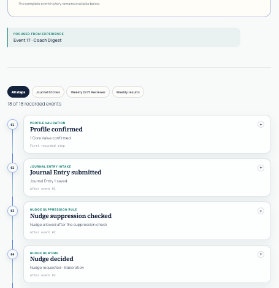{width=100% height=4.8in}\
*(b) Inspect complete event timeline*
:::

**Figure 15: Inspect for one closed week of saved replay**

:::

Each deterministic calculation (such as the Profile calculation and Drift Detector rule) is shown in full, and each model call is shown with exactly what it received and returned, but the model's internal reasoning is not exposed. In the terms of explainable AI, Inspect provides traceability of the decision process rather than interpretability of the model itself [\[38\]](#ref-38) (Figure [15](#fig-277)).

For the purpose of demo, a saved replay option was created to demonstrate how the application would work for a diverse set of users selected from the synthetic corpus. Saved replay uses full-history North Star Moment runtime outcomes for Nisha, Noor, Lukas, Wei Jun, and Meera across 27 reviewed weeks: 22 selected quotations, three ineligible outcomes, and two completed reviews with no supportive source. The summary of the synthetic Personas used in the application is shown in Figure [16](#fig-281).

::: {#source-fig-281 .source-figure source-number="16"}

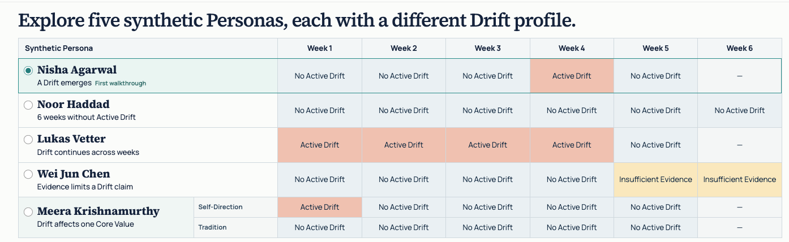{width=6.15in height=5.8in}

**Figure 16: Saved replay synthetic Personas**

:::

# 4. Results {#results .unnumbered}

## 4.1 RQ1: LLM-Judge VIF Labels match human agreement, making synthetic data suitable for model development {#rq1-llm-judge-labels-match-human-agreement-making-synthetic-data-suitable-for-model-development .unnumbered}

Section 3.2.3 set two checks on the LLM-Judge VIF Labels. Table [9](#tbl-286) summarises the results.

::: {#source-tbl-286 .source-table source-number="9" column-widths="0.234899,0.395973,0.118568,0.250559"}

**Table 9: Kappa agreement measurements**

| **Check** | **Measure** | **Target** | **Result** |
| :--- | :--- | :--- | :--- |
| Agreement with human annotators | Human--human Fleiss' $\kappa$ | \> 0.60 | 0.56 --- not met |
|  | Mean LLM-Judge--human Cohen's $\kappa$ | \> 0.60 | 0.66 --- met |
| Consistency across repeated runs | Per-value Fleiss' $\kappa$, five passes | \> 0.75 | 0.765 - 0.890 $\rightarrow$ met for all ten values |

:::

Agreement with human annotators. Human--human agreement of 0.56 is \"moderate\" on the Landis and Koch scale [\[33\]](#ref-33) and indicates annotation difficulty on the shared benchmark: three careful annotators often disagreed about which values a Journal Entry supports or works against. The LLM-Judge agreed with each annotator more closely (0.66) than the annotators agreed with one another; the mean pairwise human--human Cohen's $\kappa$ is also 0.56, so the comparison is like-for-like.

::: {#source-fig-289 .source-figure source-number="17"}

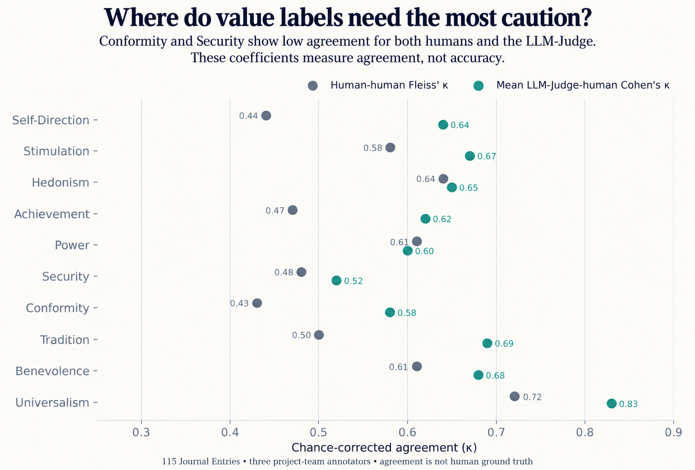{width=6.15in height=5.8in}

**Figure 17: Chance-corrected agreement on the shared 115-Journal-Entry benchmark. Grey markers show human-human Fleiss’ kappa; green markers show mean LLM-Judge-human Cohen’s kappa.**

:::

Figure 17 shows the LLM-Judge agreed with each annotator more closely than the annotators agreed with each other in nine of ten values - Power was the exception where LLM-Judge-human agreement was marginally lower (0.60 against 0.61). Human--human agreement fell below target for six values, lowest for Conformity (0.43), Self-Direction (0.44), Achievement (0.47) and Security (0.48).. As outlined in Section 3.2.3, this indicates that the values are ambiguous to judge from journal text, so their labels are less reliable. For LLM-Judge agreement stayed above the target for four of these six values. It fell below the target only for Conformity (0.58) and Security (0.52), the lowest of all ten values. For these two values, the low agreement cannot be attributed to the LLM-Judge alone. Section 4.2.4 shows the effect of repaired Security labels.

Consistency across repeated runs. For the closely related setup described in Section 3.2.3, all ten values exceeded the 0.75 target. Run-to-run randomness is therefore small next to human disagreement: the uncertainty left in the labels comes from interpreting the Journal Entry, not from the LLM-Judge changing its answer.

::: {#source-fig-293 .source-figure source-number="18"}

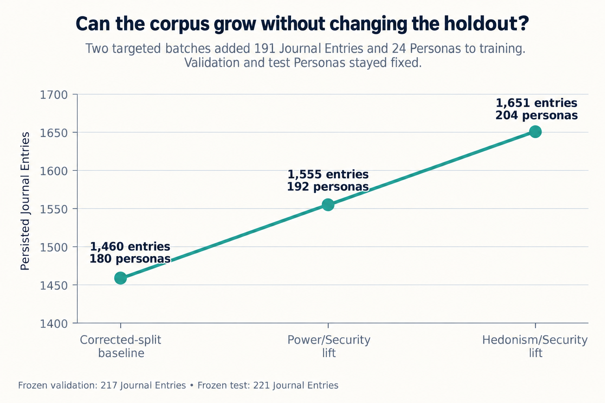{width=5.854in height=5.8in}

**Figure 18: Synthetic dataset batch evolution**

:::

Targeted synthetic batches. The two train-only batches (Section 3.2.2) produced local gains with offsetting regressions (Figure [19](#fig-297)). Growth in each batch is illustrated in Figure [18](#fig-293). Batch 1 raised Power Conflict recall from 0.125 to 0.313 while Security Conflict recall stayed at 0.571. Batch 2 raised Hedonism QWK slightly, from 0.247 to 0.256, but lowered Security QWK from 0.297 to 0.199.

::: {#source-fig-297 .source-figure source-number="19"}

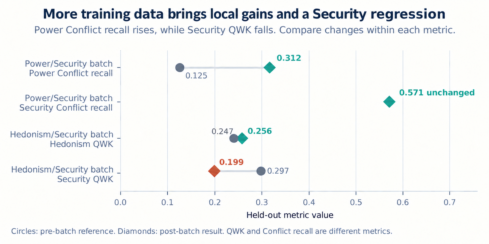{width=6.15in height=5.8in}

**Figure 19: Selected within-metric target-dimension changes from the two train-only targeted synthetic batches. QWK and Conflict recall rows are not compared with each other. Corpus growth is shown in Figure 18.**

:::

RQ1 findings: The LLM-Judge VIF Labels agree with project-team annotators more closely than the annotators agree with each other, and they are stable across repeated runs, so the synthetic corpus is suitable for developing the VIF Critic. For the values where human agreement is weakest, a low VIF Critic score may reflect ambiguous labels rather than model error.

## 4.2 RQ2: The lightweight VIF Critic learns partial signals but misses most Conflicts {#rq2-the-lightweight-vif-critic-learns-partial-signals-but-misses-most-conflicts .unnumbered}

On the frozen 221-Journal-Entry test set, the VIF Critic learned partial signals relative to the LLM-Judge VIF Labels used as the evaluation reference.

### 4.2.1 Text Representation: {#text-representation .unnumbered}

::: {#source-fig-302 .source-figure source-number="20"}

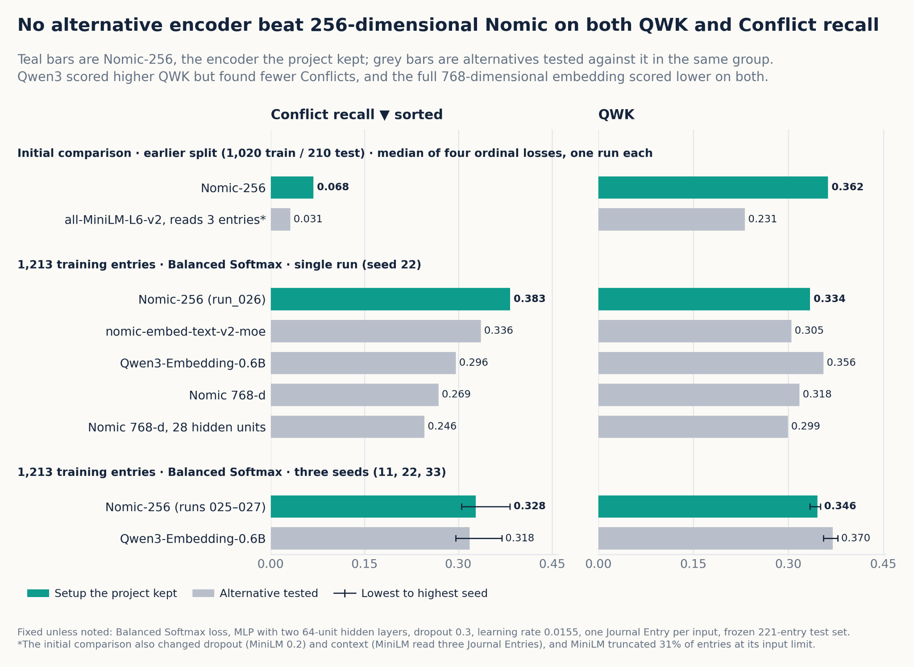{width=6.15in height=5.8in}

**Figure 20: Text representation on the frozen 221-Journal-Entry test set. Teal bars are Nomic-256, the encoder the project kept; grey bars are alternatives in the same comparison group.**

:::

No alternative encoder beats the 256-dimensional Nomic embedding on both QWK and Conflict recall (Figure [20](#fig-302)). The initial comparison preferred Nomic, reading only the current Journal Entry, to all-MiniLM-L6-v2 reading three; that comparison also changed dropout, and MiniLM truncated 31% of Journal Entries at its input limit. Against matched seed-22 controls, the full 768-dimensional Nomic embedding lowered both metrics with or without the parameter budget, so truncating to 256 dimensions did not cost performance in these runs, and nomic-embed-text-v2-moe was also weaker on both. Across three seeds, Qwen3-Embedding-0.6B raised QWK (0.370 against 0.346) but found slightly fewer Conflicts (0.318 against 0.328) and was weaker on Hedonism and Power

### 4.2.2 Loss and Training Objective: {#loss-and-training-objective .unnumbered}

::: {#source-fig-306 .source-figure source-number="21"}

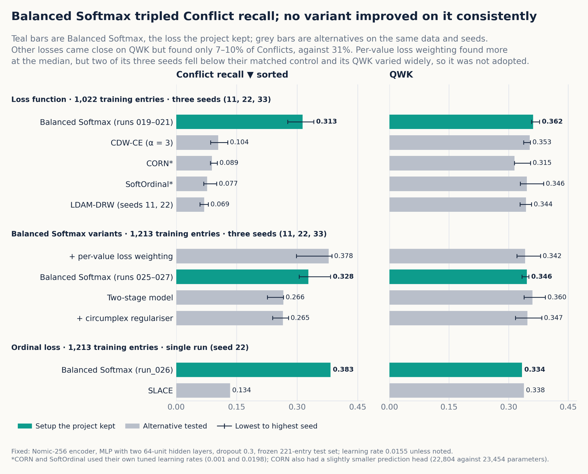{width=6.15in height=5.8in}

**Figure 21: Loss and training objective. Teal bars are Balanced Softmax, the loss the project kept; grey bars are alternatives on the same data and seeds. CORN and SoftOrdinal used their own tuned learning rates, and CORN had a slightly smaller prediction head (22,804 against 23,454 parameters).**

:::

The choice of loss had the largest effect (Figure [21](#fig-306)). The ordinal losses and LDAM-DRW stayed within 0.05 QWK of Balanced Softmax but recovered only 7--10% of Conflicts and hedged on about 80% of predictions, whereas Balanced Softmax tripled Conflict recall and cut hedging to 62%, so it became the reference loss. QWK alone would therefore have been an unsafe selection criterion.

Of the three Balanced Softmax variants, only per-value loss weighting raised median Conflict recall: 0.378 against 0.328 for its matched control on 1,213 Journal Entries, with no clear change in QWK. The gain was not consistent: two of three seeds fell slightly below their matched control (−0.007 and −0.005) and one rose (+0.059), and its QWK varied widely across seeds (0.321 to 0.381), so it was not adopted. The circumplex regulariser and the two-stage model kept QWK near their control but lowered Conflict recall to 0.265 and 0.266. SLACE, tested once, improved accuracy (0.811 against 0.728) only by predicting Neutral, the correct class for three quarters of labels, and its Conflict recall fell to 0.134.

Per-value loss weighting. Of the additions in the re-run with the full training set, only per-value loss weighting raised Conflict recall. Its gain over the earlier reference was the only one whose 95% bootstrap interval excluded zero (+0.021 to +0.128), and it came with no clear change in QWK.

Circumplex regulariser. Schwartz arranges the ten values on a circle on which neighbouring values tend to be pursued together and opposing values tend to pull against each other. The regulariser added a training penalty whenever the VIF Critic predicted the same direction for two opposing values (for example, Alignment with both Achievement and Benevolence), and a smaller reward when it predicted the same direction for neighbouring values

SLACE. SLACE penalises a prediction more the further it is from the correct class. It was tested in a single run, which looked strong on simple measures - accuracy of 0.811 and lower average error than the reference model (0.222 against 0.304). However, these gains came from predicting Neutral, which is correct for three quarters of labels and Conflict recall fell to 0.134. Because the single run already failed on Conflict recall, SLACE was not rerun with three seeds.

### 4.2.3 Training Data: {#training-data .unnumbered}

::: {#source-fig-314 .source-figure source-number="22"}

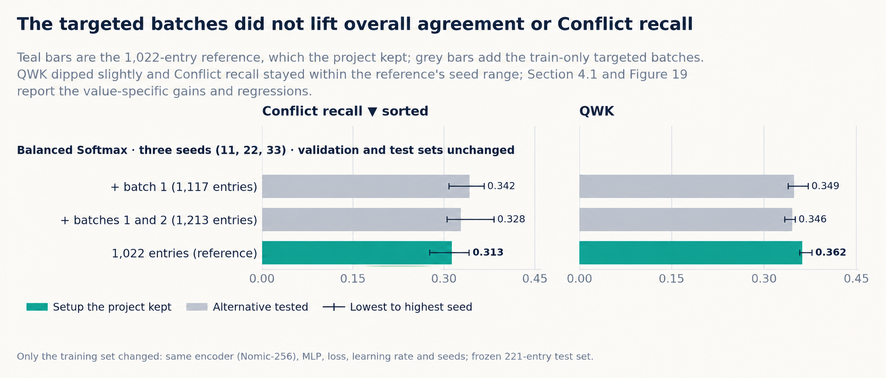{width=6.15in height=5.8in}

**Figure 22: Training data. Teal bars are the 1,022-entry reference; grey bars add train-only targeted Journal Entries. Only the training set changes.**

:::

The targeted batches (Section 3.2.2) did not lift overall agreement or Conflict recall (Figure [22](#fig-314)). QWK fell just below the reference's seed range (0.349 and 0.346 against 0.358--0.378) while Conflict recall stayed within it; Section 4.1 and Figure [19](#fig-297) report their value-specific gains and regressions. After Balanced Softmax, therefore, no model-side change moved QWK and Conflict recall together beyond seed-to-seed variation.

### 4.2.4 Label & Context Changes: {#label-context-changes .unnumbered}

::: {#source-fig-319 .source-figure source-number="23"}

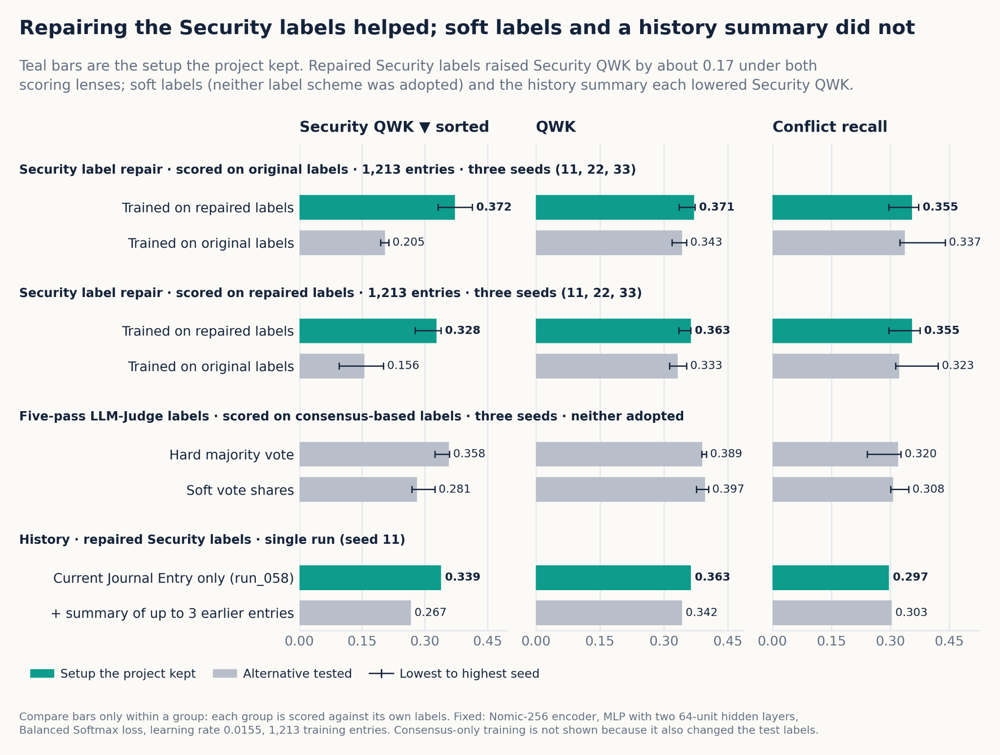{width=6.15in height=5.8in}

**Figure 23: Labels and context. Teal bars are the setup the project kept; each group is scored against its own labels, so compare bars only within a group.**

:::

If the plateau reflects the labels rather than the model, better-matched labels should help where model changes did not.

Repaired Security labels. The original Security labels drew on the Persona's biography and earlier Journal Entries, which the VIF Critic never sees (Section 3.3.4). Retraining on labels assigned from the VIF Critic's own input raised Security QWK by about 0.17 under both scoring lenses (Figure [23](#fig-319)), above any earlier run (best 0.338). Overall QWK also rose for every seed; median Conflict recall rose too, but two of three seeds fell. For Security, the limit was the label, and the repaired labels were adopted for later experiments.

Labels from the five LLM-Judge passes. Majority-vote consensus labels raised QWK to 0.372 but cut Conflict recall to 0.270, and because consensus also changed the test labels, the scores are not directly comparable. Soft vote-share labels slightly raised QWK over a matched hard-label control (0.397 against 0.389) but found fewer Conflicts (0.308 against 0.320) and were weaker on Security (QWK 0.281 against 0.358). Neither was adopted.

Context. In a single run, appending a summary of up to three earlier Journal Entries lowered QWK (0.363 to 0.342) and Security QWK (0.339 to 0.267) and left Conflict recall almost unchanged (0.297 to 0.303). History itself carries signal, however: given all earlier Journal Entries as text, gpt-5.4-mini raised its Conflict recall from 0.188 to 0.302.

### 4.2.5 VIF Critic vs LLM on the same input: {#vif-critic-vs-llm-on-the-same-input .unnumbered}

If the VIF Critic's limits came from its small size, a general-purpose LLM given the same input should do better. Section 3.3.5 describes the test: gpt-5.4-mini and gpt-5.4-nano labelled the same 221 Journal Entries from the current entry and the user's Core Values alone, with no examples or extended reasoning.

Per value (Figure [24](#fig-330)), the LLM scored higher QWK on Stimulation, Achievement, Power, Security and Universalism and the VIF Critic on Self-Direction, Hedonism and Conformity, while the VIF Critic found more Conflicts on six of the ten values and gpt-5.4-mini on three.

::: {#source-fig-330 .source-figure source-number="24"}

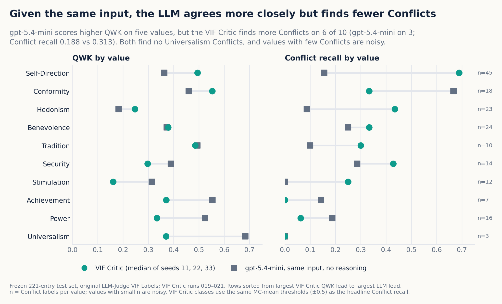{width=6.15in height=5.8in}

**Figure 24: Comparison of QWK and Conflict recall by Schwartz value**

:::

::: {#source-tbl-332 .source-table source-number="10" column-widths="0.343750,0.165179,0.162946,0.165179,0.162946"}

**Table 10: VIF Critic and LLMs given the same input, scored on the same 221-Journal-Entry test set. Each LLM was run once. The VIF Critic reference row is the median over seeds 11, 22 and 33, with the seed-22 aggregate shown separately. Figure 24 reports three-seed per-value medians; Table 11 reports seed-22 per-value QWK.**

| **Model** | **QWK** | **Conflict recall** | **Minority recall** | **Hedging** |
| :--- | :--- | :--- | :--- | :--- |
| VIF Critic, reference median | 0.362 | 0.313 | 0.448 | 0.621 |
| VIF Critic (seed 22 run_020) | 0.378 | 0.342 | 0.449 | 0.621 |
| Gpt-5.4-mini, reasoning=none | **0.434** | 0.188 | 0.428 | 0.789 |
| Gpt-5.4-nano,reasoning=none | 0.350 | 0.134 | 0.327 | 0.861 |

:::

Table [10](#tbl-332) illustrates how gpt-5.4-mini agreed more closely with the LLM-Judge overall, but found Conflict less often than the VIF Critic and frequently marked most predictions as near-neutral. The smaller gpt-5.4-nano was weaker than the VIF Critic on every measure.

::: {#source-tbl-335 .source-table source-number="11" column-widths="0.360000,0.280000,0.360000"}

**Table 11: Per-value QWK, VIF Critic (seed 22) against gpt-5.4-mini given the same input.**

| **Value** | **VIF Critic** | **gpt-5.4-mini** |
| :--- | :--- | :--- |
| Self-Direction | **0.541** | 0.363 |
| Stimulation | 0.303 | 0.314 |
| Hedonism | **0.262** | 0.182 |
| Achievement | 0.334 | **0.554** |
| Power | 0.342 | **0.524** |
| Security | 0.213 | **0.389** |
| Conformity | **0.577** | 0.460 |
| Tradition | 0.483 | 0.494 |
| Benevolence | 0.367 | 0.373 |
| Universalism | 0.355 | **0.684** |

:::

As seen in Table [11](#tbl-335), per value, the LLM (gpt-5.4-mini) did better on Achievement, Power, Security and Universalism. The VIF Critic did better on Self-Direction, Hedonism and Conformity. The two were close on Stimulation, Tradition and Benevolence.

From this result, we found the VIF Critic did not lose Conflict detection by being small, but its weakness is in overall agreement and on particular values such as Security, Achievement and Universalism, where the LLM scored higher.

::: {#source-fig-341 .source-figure source-number="25"}

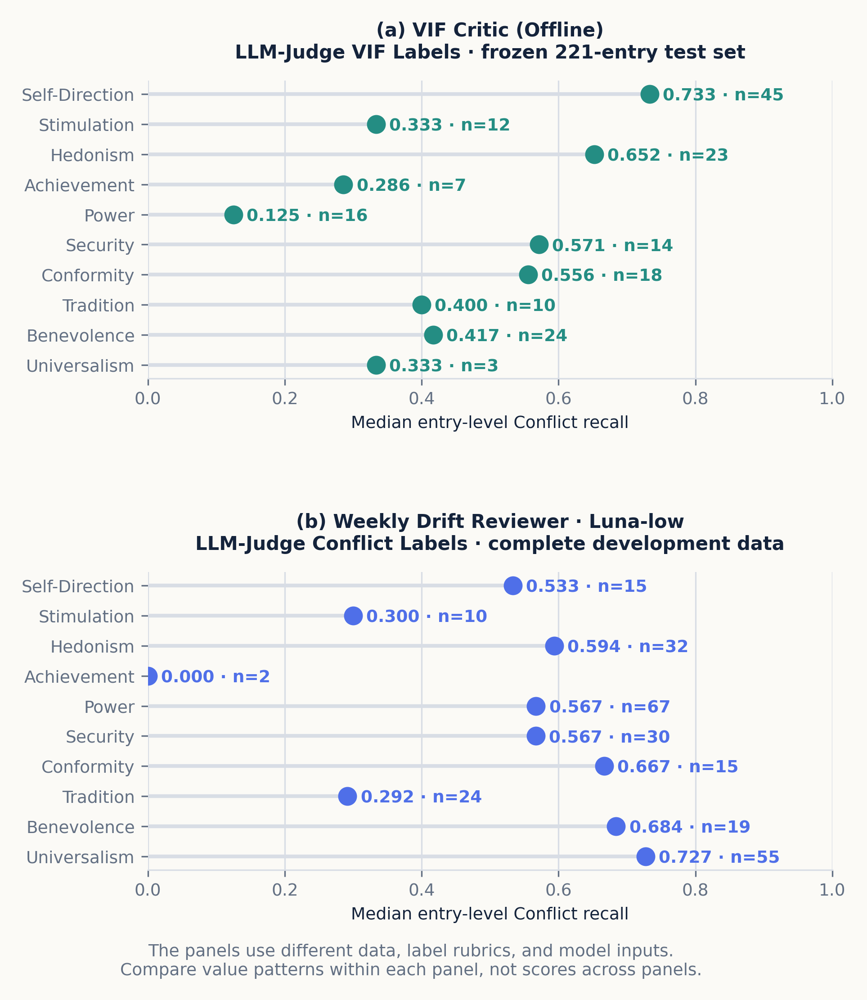{width=4.2in height=5.8in}

**Figure 25: Per-value entry-level Conflict recall under the two completed but non-comparable evaluation regimes. Panel (a) uses LLM-Judge VIF Labels for the VIF Critic on the frozen 221-Journal-Entry test set; panel (b) uses LLM-Judge Conflict Labels for luna-low on complete development data. Each label gives median recall and Conflict support.**

:::

RQ2 findings: The compact VIF Critic learns a real and reproducible signal - it finds about a third of Conflicts, more than an LLM given the same input albeit lower precision, and its uncertainty is associated with its errors (correlation 0.713). After Balanced Softmax, no encoder, objective or targeted-data change moved QWK and Conflict recall together beyond seed-to-seed variation, and the one large per-value gain came from repairing the Security labels. With median Conflict recall of 0.313 and uneven per-value results, the VIF Critic is not reliable enough to decide by itself when a user is shown a Drift - it remains an offline research contribution, and Section 4.3 describes how the Weekly Drift Reviewer took on the role of supporting user-facing Drift.

## 4.3 RQ3: Weekly Drift Detection identifies two in five Drifts with few false alerts {#rq3-the-weekly-drift-reviewer-detects-two-in-five-drifts-with-few-false-alerts .unnumbered}

This section evaluates Weekly Drift Detection in a person's Journal Entries over time: the named LLM Weekly Drift Reviewer assigns entry-level decisions, and the fixed Drift Detector identifies the resulting Drifts. With the current reviewer contract, gpt-6-luna at low reasoning effort, this workflow found a median 17 of 42 Drifts (Drift recall 0.405) with two false Drift alerts.

### 4.3.1 VIF Critic hand-off: {#vif-critic-hand-off .unnumbered}

Section 3.4.4 asked whether VIF Critic Predictions help the Weekly Drift Reviewer, either as extra input or as a trigger for an earlier review. Neither found more Drifts (Figure [26](#fig-349)). With raw VIF Critic Predictions, it found 7 Drifts, fewer in all three repeats, with three false Drift alerts, and covered 63 histories.

::: {#source-fig-349 .source-figure source-number="26"}

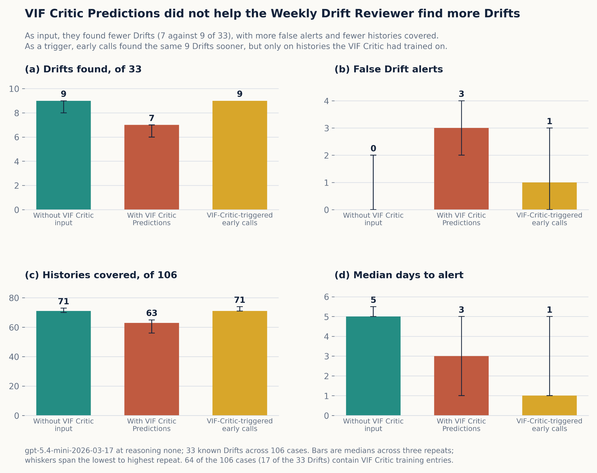{width=6.15in height=5.8in}

**Figure 26: VIF Critic hand-off on 106 development histories containing 33 Drifts, with gpt-5.4-mini at no reasoning effort. Bars are medians of three repeats; whiskers span the lowest to highest repeat.**

:::

VIF-Critic-triggered early calls found the same 9 Drifts with one false Drift alert and cut the median time to alert from five days to one. The improved (lower) detection delay came from histories the VIF Critic was trained on: 64 of the 106 histories, holding 17 of the 33 Drifts, contain its training Journal Entries. On the other 42 histories, all three setups found the same median 3 of 16 Drifts, and early calls did not shorten the delay.

Hand-off finding: VIF Critic Predictions were therefore kept out of Weekly Drift Detection. This study used gpt-5.4-mini; no similar test was run with the later Luna models (Section 4.3.2).

### 4.3.2 Weekly Drift Reviewer model and reasoning-effort studies: {#weekly-drift-reviewer-model-and-reasoning-effort-studies .unnumbered}

The model comparison held the complete 292-case development data, prompt, and three-Run design constant.

**Model Comparison: gpt-5.6-luna vs gpt-5.4-mini (prompt v0)**

::: {#source-tbl-356 .source-table source-number="12" column-widths="0.190000,0.085000,0.085000,0.090000,0.090000,0.230000,0.230000"}

**Table 12: Weekly Drift Detection results using gpt-5.4-mini or gpt-5.6-luna as the Weekly Drift Reviewer across different reasoning effort levels.**

| **Weekly Drift Reviewer**  **(Model, Reasoning Effort Level)** | **Median Drift hits** | **Median recall** | **Median false alerts** | **Median coverage** | **Paired recall difference (95% interval)** | **Paired false-alert difference (95% interval)** |
| :--- | :--- | :--- | :--- | :--- | :--- | :--- |
| gpt-5.4-mini, none | **7/42** | 0.167 | **5** | 0.740 | (Baseline) | (Baseline) |
| gpt-5.6-luna, none | **20/42** | 0.476 | **13** | **0.777** | **+0.286 \[+0.158, +0.425\]** | +9 \[+2, +17\] |
| gpt-5.6-luna, low | **23/42** | 0.548 | **4** | **0.637** | (Baseline) | (Baseline) |
| gpt-5.6-luna, medium | 24/42 | 0.571 | 4 | 0.682 | 0.000 \[−0.085, +0.077\] | −1 \[−2, +3\] vs low |
| gpt-5.6-luna, high | 26/42 | 0.619 | **8** | 0.716 | +0.048 \[−0.023, +0.128\] | +4 \[0, +7\] |
| gpt-5.6-luna, xhigh | 28/42 | 0.667 | **9** | 0.702 | +0.095 \[+0.023, +0.186\] | +5 \[+1, +9\] |

:::

Section 3.4.4 asked which model and reasoning effort the Weekly Drift Reviewer should use, ranking Drift recall first and false Drift alerts second. We documented our findings in Table [12](#tbl-356) and made the following observations. With no reasoning, gpt-5.6-luna found nearly three times as many Drifts as gpt-5.4-mini as seen by the increase in the median Drift hits (20 vs 7) and higher paired recall difference +0.286, but raised false Drift alerts from 5 to 13. This is made clearer in Figure [27](#fig-361)(a), where gpt-5.6-luna at none significantly out-performs gpt-5.4-mini at none reasoning level.

Low reasoning effort cut false Drift alerts from 13 to 4 and found 23 Drifts against 20, but its recall gain was not established (+0.071). It also abstained more, covering 186 rather than 227 of 292 histories, the loss that failed the preregistered rule in Section 3.4.4 and resulted in a lower median coverage. Medium did not establish a Drift-recall gain over low. High and xhigh found more Drifts (26 and 28) but at least doubled the false Drift alerts (8 and 9), and only xhigh's recall gain was established (+0.095). Because Drifts found and false Drift alerts rose together above low, we kept low.

::: {#source-fig-361 .source-figure source-number="27"}

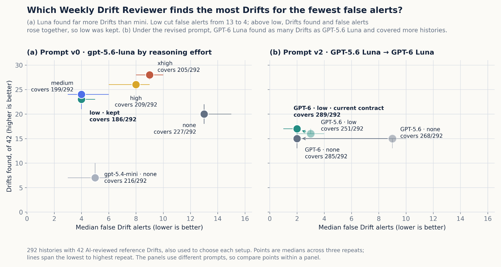{width=6.15in height=5.8in}

**Figure 27: Weekly Drift Detection operating points on 292 development histories containing 42 Drifts. (a) Prompt v0: gpt-5.6-luna at each reasoning effort, and gpt-5.4-mini. (b) Prompt v2: gpt-5.6-luna against gpt-6-luna, with arrows for the model change. Points are medians of three repeats; lines span the lowest to highest repeat. The panels use different prompts.**

:::

**Model Comparison: gpt-6-luna vs gpt-5.6-luna (prompt v2)**

::: {#source-tbl-365 .source-table source-number="13" column-widths="0.141256,0.219731,0.096413,0.154709,0.100897,0.143498,0.143498"}

**Table 13: Weekly Drift Detection results using gpt-5.6-luna or gpt-6-luna as the Weekly Drift Reviewer across different reasoning effort levels. gpt-5.6-luna performance was also compared across the prompt versions.**

| **Prompt Version** | **Weekly Drift Reviewer** | **Median Drift hits** | **Median recall** | **Median false alerts** | **Median coverage** | **Calculated token cost, three Runs** |
| :--- | :--- | :--- | :--- | :--- | :--- | :--- |
| v0 | gpt-5.6-luna, low | **23/42** | 0.548 | 4 | 0.637 (186/292 histories) | --- |
| v2 | gpt-5.6-luna, low | **16/42** | 0.381 | **3** | 0.860 (251/292) | **\$1.2730** |
|  | **gpt-6-luna, low** | **17/42** | 0.405 | **2** | **0.990 (289/292)** | **\$0.5083** |
|  | gpt-6-luna, medium | 19/42 | 0.452 | 2 | 0.986 | \$0.6736 |
|  | gpt-6-luna, high | 17/42 | 0.405 | 2 | 0.976 | \$0.8381 |
|  | gpt-6-luna, xhigh | 19/42 | 0.452 | 2 | 0.966 | \$1.1121 |

:::

At low reasoning effort, the two found a similar number of Drifts (17 and 16), but gpt-6-luna had a 15% higher coverage at around 60% lower calculated token cost as seen in Table [13](#tbl-365). Median false Drift alerts improved slightly (3 $\rightarrow$ 2). On coverage and cost, gpt-6-luna at low reasoning effort became the current contract, as indicated by the green markers in Figure [27](#fig-361)(b).

The current contract finds fewer Drifts (17 of 42) than the 23 in Table [12](#tbl-356) because the prompt also changed. With prompt v2, gpt-5.6-luna at low reasoning effort found 16 Drifts against 23 with prompt v0, while it covered 251 rather than 186 histories indicating a higher coverage.

A follow-up at medium, high and xhigh reasoning effort found median Drift recall of 0.452, 0.405 and 0.452 for gpt-6-luna under prompt v2; this series does not show that more reasoning finds more Drifts. gpt-6-luna low had the highest coverage and lowest calculated token cost among the low-to-xhigh settings. Medium and xhigh each found a median 19 Drifts versus 17 at low, while all four settings had two median false alerts. No higher effort established a Drift-recall gain over low.

### 4.3.3 Effect of Core Value definitions on Drift detection: {#effect-of-core-value-definitions-on-drift-detection .unnumbered}

The [Core Value definition study](https://github.com/DesmondChoy/twinkl/blob/af22ab457994fd2863fe5b5b7735f768f211519b/logs/experiments/reports/experiment_review_2026-09-07_twinkl_j3k7_core_value_definitions.md) tested whether supplying definitions and motivational descriptions changed detected Drifts. These descriptions combine Schwartz-based definitions with project-specific elaborations. Both prompt setups used the same 204 Personas, 951 observed weeks, Journal Entry input, model settings, response format, and deterministic rules.

Adding the descriptions (prompt v2 as mentioned in Section 3.4.4) reduced the median detected Drifts from 22 to 19. Between 305 and 319 of the 2,377 Journal Entry/Core Value decisions changed in each paired repeat. Aggregate counts also concealed changes in which Personas were identified: one repeat retained two Conformity Drifts while identifying different Personas in each prompt setup. For this offline comparison, 22 invalid reviews were encoded as Abstain. These were invalid-review outcomes rather than valid too-little-evidence decisions; failed reviews in the application yield Insufficient Evidence.

The comparison shows that additional value context can alter both detection frequency and the histories identified. It did not measure accuracy against reference labels, and variation between repeats limits attribution of individual changes.

RQ3 findings: Using the Weekly Drift Reviewer’s decisions from cumulative Journal Entry history and the fixed Drift Detector, Weekly Drift Detection finds about two in five Drifts with few false alerts: the current contract found a median 17 of 42 Drifts with two false Drift alerts. VIF Critic Predictions did not help it find more Drifts, and the choice of model made the largest established difference. Above low reasoning effort, Drift recall and false Drift alerts rose together, and prompt revisions changed which Drifts were found.

## 4.4 RQ4: The right North Star Moment depends on when, not just what {#rq4-the-right-north-star-moment-depends-on-when-not-just-what .unnumbered}

How faithfully can LLMs preserve and retrieve the words and meaning of a person's Journal Entries when generating reflections? The clearest answer comes from the North Star Moment. Finding supportive writing was easy; choosing the right quotation depended on when it was written as well as what it says, so full eligible history beat top-three retrieval, and a correct quotation made the Coach Digest better grounded (Section 4.4.2). The Coach Digest evidence is weaker, because the AI evaluator missed a known factual error (Section 4.4.1).

### 4.4.1 Coach Digest generation and semantic review: {#coach-digest-generation-and-semantic-review .unnumbered}

Section 3.5.1 questions if the Coach Digest reflects the week's Journal Entries accurately, without being a therapist and telling the person what to do.

The evaluation covered five Coach Digests with Coach Digest prompt 4.1, each from a different Persona's highlighted week. The AI evaluator, gpt-5.6-luna at no reasoning effort and the same model that wrote the responses, scored each one from 1 to 5 on the four criteria of the [Coach Digest Evals](https://github.com/DesmondChoy/twinkl/blob/main/docs/evals/explanation_quality_eval.md#coach-digest-evals) [rubric](https://github.com/DesmondChoy/twinkl/blob/main/docs/evals/explanation_quality_eval.md#coach-digest-evals); a score below 3 flags a response for review. The means across the five were:

- Correctness: 4.80

- Specificity: 5.00

- Non-prescriptive tone: 5.00

- Tension honesty: 4.60. One response scored 3 for implying a current tension although neither Core Value had Active Drift.

In a separate saved-response audit, AI editorial review identified material source or chronology problems in 9 of 39 Coach Digests that had passed deterministic validation. A subsequent diagnostic gave a known event connection correctness scores of 5/5 with short excerpts and 4/5 with complete source entries, neither triggering a review flag, which required the scores to be below 3. These high AI correctness scores did not reliably establish source fidelity in the diagnostic: the evaluator missed an event-attribution error even when supplied with complete source entries. This will be discussed further in Section 6.4 as part of our findings.

### 4.4.2 North Star Moment results: {#north-star-moment-results .unnumbered}

Section 3.5.2 asked whether choosing the North Star Moment from the full eligible history finds correct quotations more often than choosing among the top three Journal Entries retrieved with Nomic.

Full eligible history achieved higher Card precision and Opportunity recall than Nomic top-three retrieval in both partitions after the targeted update. Table [14](#tbl-385) reports the metric-specific numerators and denominators after the fixed shared-reference adjudication and paired exclusions. An incorrect displayed selection can contribute both a false positive for precision and a missed opportunity for recall; displaying a supportive quotation alone is insufficient if it violates full-history selection priority.

::: {#source-tbl-385 .source-table source-number="14" column-widths="0.170764,0.328565,0.250335,0.250335"}

**Table 14: AI-reviewed NSM results across 391 development and 110 qualified-final weeks.**

| **Partition** | **NSM method or comparison** | **Card precision** | **Opportunity recall** |
| :--- | :--- | :--- | :--- |
| Development | Nomic top three | 181/309 = 58.58% | 181/327 = 55.35% |
| Development | Full eligible history | 244/323 = 75.54% | 244/327 = 74.62% |
| Development | **Nomic $-$ full history, percentage points \[95% interval\]** | **−16.97 \[−23.14, −10.72\]** | **−19.27 \[−25.45, −12.72\]** |
| Qualified final | Nomic top three | 49/85 = 57.65% | 49/86 = 56.98% |
| Qualified final | Full eligible history | 70/85 = 82.35% | 70/86 = 81.40% |
| Qualified final | **Nomic $-$ full history, percentage points \[95% interval\]** | **−24.71 \[−36.18, −10.75\]** | **−24.42 \[−36.47, −9.88\]** |

:::

::: {#source-fig-387 .source-figure source-number="28"}

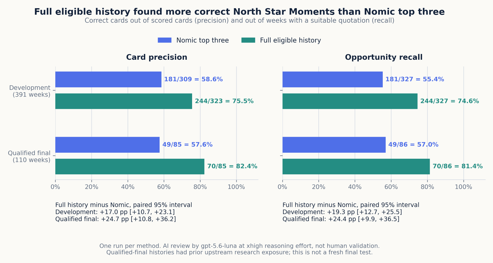{width=6.15in height=5.8in}

**Figure 28: North Star Moment selection after the targeted update, on 391 development and 110 qualified-final weeks from 105 synthetic Personas. Correctness is AI review by gpt-5.6-luna at xhigh reasoning effort, not human validation. Paired 95% intervals come from 10,000 resamples of whole Personas. Each method ran once.**

:::

Retrieval was not the bottleneck. Nomic's top three almost always contained supportive writing (342 of 348 development and 96 of 96 qualified-final weeks), yet its cards followed the selection rules far less often than full history's: 185 of 309 against 255 of 322, and 51 of 85 against 73 of 85. Those rules depend on timing, such as writing from before Drift onset or from the current week, which similarity ranking ignores. Full history fits easily here, at under about 4,100 input tokens per request, but costs 1.6 to 1.8 times as much and will not scale to years of writing; applying the timing rules before ranking is the untested alternative.

The paired intervals in Figure [28](#fig-387) favour full eligible history for both outcomes in both partitions under the tested configuration. The qualified-final histories had prior upstream research exposure, and the targeted update retained earlier observations, so these results do not establish general superiority across users or evaluators. On a fixed 20-Persona sample that the evaluator assessed three times, source-decision agreement was 341/384 (88.80%) and exact-quotation acceptance agreement was 107/109 (98.17%); neither measures human validity.

Section 1.2 also asked whether a correct North Star Moment makes the Coach Digest better grounded in the person's own actions. We observe that it does, at a small cost: under a blinded AI judge, the Coach Digest with the North Star Moment won 36 of 72 weeks and lost 12, with 24 ties, a win difference of +33.3 points (95% Persona-resampled interval +19.4 to +45.5), but it was occasionally flagged for softening a Conflict.

For each of the 72 weeks, gpt-5.6-luna (the live Coach Digest model), wrote two Coach Digests from the same input, with and without the North Star Moment. A Claude Opus 5.5 judge compared each pair in both presentation orders, counting a win or loss only when the orders agreed; they agreed in 61 of 72 weeks. It flagged the version with the North Star Moment for softening a Conflict in 2 of 144 judgments, against none without it. The 72 weeks come from the original selection run (72 of 86 correct cards), before the targeted update in Figure [28](#fig-387). The judge rated only grounding, and it comes from the model family that wrote the synthetic Journal Entries.

RQ4 findings: The right North Star Moment depends on when the writing happened, not just what it says. Top-three retrieval almost always found supportive writing but often broke the timing rules, so the full eligible history found more correct quotations (70 against 49 of 85 qualified-final cards). A correct North Star Moment also made the Coach Digest better grounded in the person's own action, with a small risk of softening a Conflict.

# 5. Implementation and Verification {#implementation-and-verification .unnumbered}

This section describes how the working application was verified (5.2), and what the deployment covers (5.3).

## 5.1 Implementation and demonstration: {#implementation-and-demonstration .unnumbered}

The application has a React frontend and a Python service. React runs onboarding, calculates the Profile and keeps the session in the browser. The Python service validates each request, calls the models, applies the Drift Detector and records each step as an Inspect event (Section 3.6.3). Both sides follow one versioned contract. A sample session generated by the Python service is validated by both the Python and React tests, so a change on one side that breaks the other fails a test.

The application runs in two modes. Saved replay presents the five synthetic Personas from recorded model responses and makes no model calls. Together they show Drift forming and continuing, No Active Drift, Insufficient Evidence, and two Core Values in different states, with verification scope recorded in Appendices B and C. Section 3.6 shows the main screens. Manual journaling runs the same steps on the user's own Journal Entries with live model calls.

The implementation follows established software and AI engineering practices. On the software side, the frontend and Python service share a versioned contract, dependencies are locked, and confirmed defects gained regression tests (Section 5.2). On the AI side, each live model call records its model, prompt version and response (Appendix A). outputs are validated before display and withheld when invalid; Journal Entry text is kept apart from instructions (Section 6.7); the Weekly Drift Reviewer's model and prompt were chosen by comparison against reference Drifts (Section 4.3); live North Star Moment spending is capped; and AI review is labelled as such rather than treated as human validation.

## 5.2 Verification and failure recovery: {#verification-and-failure-recovery .unnumbered}

Unit tests exercise Profile scoring and Drift Detector transitions, while integration tests check evidence preservation and session consistency. Simulated provider failures test response handling and retry behaviour, and browser tests run the React application against the Python service with controlled model responses. These tests check application behaviour, not the quality of model output. Table [15](#tbl-405) lists the main behaviours they check.

::: {#source-tbl-405 .source-table source-number="15" column-widths="0.333333,0.333333,0.333333"}

**Table 15: Application behaviours checked by automated tests.**

| **Condition** | **Verified behaviour** | **Evidence** |
| :--- | :--- | :--- |
| Two Conflicts in a row, across a week boundary | Active Drift forms for that Core Value; a later Not Conflict ends it and keeps the Historical Drift Record | Drift Detector tests |
| An Abstain or Journal Entry gap blocks a current claim after recent Conflict evidence; or a review fails | Insufficient Evidence; no Drift is claimed without support | Drift Detector and service tests |
| A model response quotes Journal Entries | Every extracted quotation must match its source; one invented quotation fails the response | Mixed genuine and invented quotation cases |
| A provider refuses, returns an incomplete response or fails | Retries follow the recorded policy; refused and incomplete responses are not shown | Simulated failures through the provider client library |
| Coach Digest generation fails | The Weekly Drift Detection result stays available; retry does not repeat the completed review | React integration tests and a Chromium journey |
| The page reloads, or the user confirms deletion | The selected week and Inspect context survive reload; deletion clears browser state and the matching Python session | Chromium journeys |

:::

Table [16](#tbl-409) reports the last run that covered every suite.

::: {#source-tbl-409 .source-table source-number="16" column-widths="0.333333,0.333333,0.333333"}

**Table 16: Verification completed without paid model calls.**

| **Verification** | **Result** | **Scope** |
| :--- | :--- | :--- |
| Python | 2,111 passed | Full repository suite, including research compatibility and application tests |
| Frontend | 385 passed across 24 files | React component and integration tests |
| Browser | Two journeys passed | Saved replay through Inspect and reload; manual onboarding through weekly review, Coach Digest retry and deletion. Chromium, mobile viewport |
| Build and lint | Passed | TypeScript/Vite build and Ruff for changed Python files |
| Type checking | Eight focused files passed | Existing errors remained in two additionally checked modules; not a clean repository-wide MyPy result |

:::

::: {#source-fig-412 .source-figure source-number="29"}

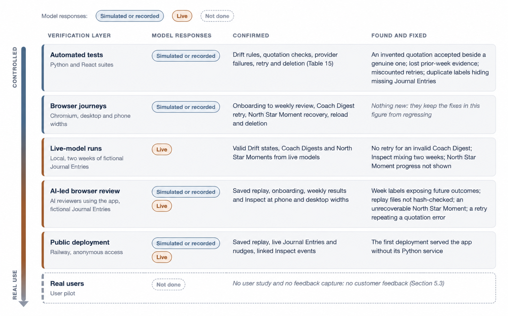{width=6.15in height=5.8in}

**Figure 29: Verification layers, from controlled tests to real use. Each layer is marked by the model responses it used: simulated or recorded, or live.**

:::

Each layer in Figure [29](#fig-412) found problems that the more controlled layers had missed: automated tests found data-handling defects, live-model runs and AI reviewers found gaps in recovery and display, and the first public deployment lacked its Python service. All were fixed, and the code defects gained regression tests.

## 5.3 Deployment and limits: {#deployment-and-limits .unnumbered}

The application is deployed on Railway for assessment at [`https://onboarding-production-1dd2.up.railway.app/`](https://onboarding-production-1dd2.up.railway.app/). Anyone with the link can use it. Public checks covered saved replay, live Journal Entry work and linked Inspect events; the latest fixes were verified locally. Live North Star Moment selection stops once a shared US\$1 allowance is spent. The deployment has no user accounts, persistent multi-user storage or service commitments.

No real user has used the application. Coach Digest feedback capture was not built and the user pilot was not conducted, so the application has no customer-feedback evidence (Section 7).

# 6. Discussion {#discussion .unnumbered}

Twinkl's findings show how synthetic-data design, model evaluation, and component selection shaped the implemented application. Inspect and regression tests make these decisions traceable and check application behaviour, while the synthetic and AI-reviewed evidence limits conclusions about performance with real users.

## 6.1 Most label disagreements concern whether value evidence is present {#most-label-disagreements-concern-whether-value-evidence-is-present .unnumbered}

A value label can be wrong in two ways: about whether a value is involved in a Journal Entry at all, or about whether the entry supports or goes against it.

::: {#source-tbl-424 .source-table source-number="17" column-widths="0.333333,0.333333,0.333333"}

**Table 17: Comparison of three kinds of disagreement that arise from different sources, yet all three concentrate on the first.**

| **Comparison** | **About presence** | **About direction** |
| :--- | :--- | :--- |
| Human vs human: Three human annotators, 115 shared Journal Entries (RQ1, Section 4.1) | 584 of 607 disagreements (96%) | 23 (4%) |
| LLM vs LLM, different model and inputs: original Security LLM-Judge VIF Labels, made with the Persona's biography and earlier Journal Entries, against gpt-5.4-mini relabels made from the Journal Entry alone (RQ2, Sections 3.3.4 and 4.2.4) | 619 of 678 changes (91%) | 59 (9%) |
| Same LLM, repeated: three runs of the Weekly Drift Reviewer (gpt-5.6-luna, low reasoning effort) with the prompt without definitions, compared in pairs (RQ3, Section 4.3.3) | 240--253 of 265--274 changed decisions involved Abstain | 20--25 Conflict $\leftrightarrow$ Not Conflict |

:::

The pattern holds whether the two labels come from different people, from different LLMs given different information, or from the same LLM run again, which suggests it is a property of the task rather than of any one labeller. External studies point the same way. Epstein et al. trained 1,079 annotators on the meaning of Schwartz values and screened them on clear examples, yet agreement on social media posts stayed low; the authors argued that some posts allow multiple valid value interpretations [\[39\]](#ref-39). Part of the difficulty lies in behaviour itself. Bardi and Schwartz found weaker value–behaviour associations for Security, Conformity, Achievement and Benevolence, and proposed normative pressure as one explanation [\[40\]](#ref-40). In Twinkl, an entry about helping a colleague could reflect Benevolence or workplace norms; this is our interpretation of why the same behaviour may be ambiguous evidence. Some disagreement about presence may therefore be irreducible from the text alone, while some reflects annotators applying different thresholds to the same evidence; Section 6.6 addresses the second.

The VIF Critic also fails at the value detection step. Its two-stage variant first predicts whether each value is involved and only then predicts the direction for the values that are. Once it judged a value involved, it chose the correct direction as often as the reference model (0.778 for both), but it recognised fewer of the involved cases (0.676 against 0.745; Section 4.2.2). Yeste and Rosso report the same weakness: a model that must first detect a broader value group cannot recover what that first step misses [\[41\]](#ref-41).

The first stage did not help because of the class-imbalance problem: the label distribution rewards caution. About three quarters of labels are Neutral (Table [3](#tbl-130)), so a model predicting Neutral (declaring a value not involved) would usually be right. The VIF Critic already corrects for this with Balanced Softmax, which adjusts training for class frequencies [\[21\]](#ref-21) and tripled Conflict recall over the ordinal losses (Section 4.2.2), yet further pressure towards caution still drained into Neutral. The two-stage variant became more cautious about calling a value involved: when it did, it was more often correct, but it caught fewer of the involved cases.

The circumplex regulariser (another VIF Critic variant), which penalised predicting the same direction for two opposing Schwartz values, also became more cautious, since a Neutral prediction can never incur that penalty. In both cases the extra Neutral predictions cost little QWK, because most of them were correct, while Conflict recall fell from 0.328 to 0.266 and 0.265 (Section 4.2.2).

Value-specific fixes succeeded only when they addressed the cause. The targeted batches added examples for weak values and produced local gains offset by regressions on other values (Section 4.1, Figure 19). Relabelling Security from the VIF Critic's own input was the one change that lifted a weak value without lowering another metric (Section 4.2.4, Figure 23), because it removed that value's specific problem: labels that depended on context the VIF Critic never receives. Most of those relabels changed whether Security was involved (Table 17), so the fix acted at the step where the VIF Critic fails. Improving value detection on imbalanced, subjective labels therefore begins with diagnosing why each value fails, not with a general remedy.

## 6.2 Conflict detection remains poor across all models {#conflict-detection-remains-poor-across-all-models .unnumbered}

However, -1 Conflict detection remained poor. The gpt-5.4-mini found only 19% of Conflicts, against the VIF Critic's 31%, and every model found Alignment far more often than Conflict. Conflict stacks every difficulty above - it is rare (7% of labels, against 17% for Alignment), it must cross the subjective involvement boundary, and it is often quiet.

Power shows this most clearly - gpt-5.4-mini recognised Power well yet found only 18% of Power Conflicts, because Power is often broken by doing nothing. The Weekly Drift Reviewer, a separate setup, lost the same cases when its rules tightened. Human judgement studies have found that harmful omissions can be judged more leniently than equivalent harmful actions [\[42\]](#ref-42). This offers an analogy; whether Twinkl's evidence rule causes a similar bias requires direct evaluation. Tradition follows the same pattern as Power: models recognised it well (QWK 0.485 for the VIF Critic, 0.494 for gpt-5.4-mini) but without earlier Journal Entries, gpt-5.4-mini found only 10% (1 of 10) of its Conflicts. The Weekly Drift Reviewer, which is not trained on Twinkl data, also flagged Tradition with a low precision score - 0.60, which points to confusion and suggests that the weakness lies partly in how rarely or indirectly these values appear in the synthetic Journal Entries.

Providing the LLM earlier Journal Entries helped for certain values and raised gpt-5.4-mini's Conflict recall from 0.188 to 0.302, still far below its Alignment recall (0.765). Security doubled (0.286 to 0.571), and Tradition and Self-Direction rose, but Hedonism and Achievement did not. Longer-term values may need context that in-the-moment values do not.

## 6.3 Model choice moved Drift recall most; extra reasoning gave smaller, uneven returns {#model-choice-moved-drift-recall-most-extra-reasoning-gave-smaller-uneven-returns .unnumbered}

Section 4.3.2 varied two settings of the Weekly Drift Reviewer: the model and its reasoning effort.

- Replacing gpt-5.4-mini with gpt-5.6-luna produced the largest established gain in Drift recall, +0.286 (Table [12](#tbl-356)).

- The largest established gain from reasoning effort was smaller: gpt-5.6-luna's move from none to xhigh under prompt v0 was +0.191 (Table [12](#tbl-356)).

- Under prompt v2, gpt-6-luna's median detections ranged from 15 to 19 across the five efforts (Table [13](#tbl-365), Figure [27](#fig-361)(b)). Raising its reasoning effort from low to xhigh found a median of two more Drifts, but the paired difference remained uncertain: its 95% interval ranges from about two fewer to six more Drifts (+0.048 \[−0.053, +0.140\]).

The two settings changed different things. A stronger model improved recognition itself: moving from gpt-5.4-mini to gpt-5.6-luna doubled Conflict recall on individual Journal Entries, from 0.245 to 0.513. Reasoning effort instead moved the reviewer along a trade-off between finding Drifts, raising false Drift alerts and declining to decide. For gpt-5.6-luna under prompt v0, low effort sharply cut false Drift alerts without an established recall gain (Table 12, Figure 27(a)), but partly by abstaining due to lack of evidence. In the separate prompt-v2 study, of the 26 histories it wrongly flagged at no reasoning effort, 9 became abstentions at low and only 9 were corrected. Fewer false alerts can therefore mean fewer decisions, so coverage must be read alongside them [\[24\]](#ref-24). Beyond low reasoning, extra effort found more Drifts only by adding false alerts: under prompt v0, xhigh found five more Drifts than low but also five more false alerts (Table 12).

How much reasoning effort could help depended on the model. With no reasoning effort, gpt-6-luna had as few false alerts as gpt-5.6-luna at low. It also covered more histories at every effort, at less than half the token cost (Table [13](#tbl-365), Figure [27](#fig-361)(b)). With false alerts already low, extra effort established no further gain in either false alerts or Drift recall.

We therefore adopted gpt-6-luna at low reasoning effort, since no higher effort established better Drift recall. The choice still involves a trade-off: gpt-5.6-luna at xhigh found the most Drifts of any prompt-v2 setting, though not by an established margin over gpt-6-luna. The broader lesson is that reasoning effort must earn its cost through measured gains in Drift recall, false Drift alerts and coverage, rather than being assumed to improve quality

Related work points the same way. Sprague et al. found that chain-of-thought prompting produced its strongest benefits on mathematical and symbolic tasks [\[43\]](#ref-43), motivating separate evaluation of reasoning for value--behaviour assessment. Kapoor et al. argue more generally that AI systems should be evaluated on cost as well as accuracy, after finding that costlier agents often did no better than simple baselines [\[44\]](#ref-44). These studies examined different tasks and interventions, so they support evaluation on the intended task rather than explaining Twinkl's trade-offs. Choosing the model and choosing reasoning effort are separate decisions that each need their own evaluation.

Sutton's "bitter lesson" provides a useful perspective on these results through its emphasis on general methods that can exploit increasing computation [\[45\]](#ref-45). Twinkl's largest observed recall gain came from changing the general model, while additional reasoning produced smaller and less consistent benefits. These comparisons do not isolate training compute or test Sutton's claim about long-term progress, but rather illustrate why access to a stronger model and allocating more computation to an existing model should be evaluated separately. On MATH with PaLM-2 models, Snell et al. found that the effectiveness of test-time computation depends on the base model, problem difficulty and inference strategy [\[46\]](#ref-46). Twinkl applies this practical concern to value--behaviour assessment, where gains must be judged alongside false alerts and abstention. Its fixed two-Conflict rule supplies an explicit, auditable definition of Drift against which those configurations can be compared.

## 6.4 Preserving exact words does not guarantee preserving meaning {#preserving-exact-words-does-not-guarantee-preserving-meaning .unnumbered}

Coach Digest Validations confirm that each quotation in a Coach Digest matches the user's writing word for word, but they cannot tell whether the Coach Digest describes that quotation correctly: whether it is attached to the right event, placed at the right time, or given the right reason (Section 3.5.1). We saw this gap when building the North Star Moment comparison ([report](https://github.com/DesmondChoy/twinkl/blob/main/logs/experiments/reports/demo_coach_nsm_comparison_20260909/report.md#generation-and-editorial-repair)).

For 22 weeks across five demo Personas, gpt-5.6-luna wrote two Coach Digests from the same week's writing, one that also saw the selected North Star Moment and one that did not. Of the 44 Coach Digests, 39 passed Coach Digest Validations. An AI reviewer then read each of the 39 against the writing it was based on and found serious errors in nine, five that had seen the North Star Moment and four that had not.

In some, a real quotation was attached to the wrong event: a remark about staying silent at an earlier onboarding meeting was presented as part of a later decision about buying coffee. In others, the Coach Digest invented a motive the writing never gave, such as treating a child's shell collecting as a beach clean-up. A Coach Digest can therefore quote someone exactly and still misrepresent what they meant. Each of the nine was regenerated with written correction instructions rather than edited by hand. Table [18](#tbl-447) shows an example of how the short excerpts obscured that distinction and how the complete selected Journal Entries restored it, and the six-response source-context diagnostic's inputs and provenance are recorded in the [run manifest](https://github.com/DesmondChoy/twinkl/blob/main/logs/experiments/reports/coach_context_eval_20260913/manifest.json).

::: {#source-tbl-447 .source-table source-number="18" column-widths="0.164444,0.391111,0.444444"}

**Table 18: Short excerpts and relevant restored context from the synthetic Persona writing used in the Coach Digest diagnostic. The ellipsis in the June 25 short excerpt was present in the supplied input.**

| **Journal Entry** | **Short excerpt supplied** | **Relevant passage available in the complete entry** |
| :--- | :--- | :--- |
| **June 25: request to skip validation** | "Sprint deadline tomorrow and I'm at the office late. The PM asked me to cut corners on the data validation layer for the remittance feature, the same one Ravi flagged weeks ago. She said we'll circle back to it after\..." | "I said okay. I could have pushed back, could have said the validation matters because real people's money is on the line and if we ship it broken the ones who suffer are the ones who can least afford it." |
| **July 1: discussion about fixing the failures** | "I nodded. Again. I keep telling myself I'll escalate next time, build the case, find the right moment." | "Brought it up in a 1:1 with my lead. He agreed it's a problem but said the next sprint is already planned and we can't squeeze it in. I nodded. Again." |

:::

Wei Jun did agree to skip validation on June 25, and the error was assigning the July 1 nod to that request. The nod in July 1 was in response to pushing the fix back rather than cutting corners and skipping data validation altogether.

As seen in section 4.4.1, the same incorrect Coach Digest received correctness scores that did not trigger review. Although the complete entries explicitly located the nod in the conversation with his lead, the evaluator did not identify the misattribution. The evaluator lowered the score because the Coach Digest implied that Wei Jun had kept the concern in the background, although the July 1 entry showed that he had raised it with his lead, potentially blurring lines in the context here.

The evaluator was instructed to reject invented or misread events, but its rubric combined factual accuracy and policy compliance into one correctness score without requiring individual claims to be matched to dated sources. Its brief justification acknowledged genuine details without verifying their connection, while the rubric specified a low-score requirement for material policy mismatches but no equivalent requirement for event-attribution errors. Complete source context also reduced clear attribution errors, but unsupported causal generalisations remained.

These observations support Maynez et al.'s account of unsupported synthesis from source information. The model assembled genuine source information into a causal relationship that contradicted evidence, resulting in a misinterpretation of source information, and this is consistent with the definition of an intrinsic hallucination [\[25\]](#ref-25). This also supports Min et al.'s rationale for checking individual claims rather than relying solely on an overall assessment [\[27\]](#ref-27).

For RQ4, the implication is that faithful reflection requires checking attribution, chronology and causal interpretation alongside exact quotation matches. Complete evidence makes these checks possible, but does not ensure that either the generator or evaluator performs them reliably. These observations come from synthetic Persona writing and AI review, highlighting the importance of human validation, and establishing a demonstrated failure mode.

## 6.5 Limitations {#limitations .unnumbered}

The synthetic corpus provides designed demographic and narrative coverage rather than population representativeness. Generation and original labelling used the same model family, so their errors may be correlated, but this was not measured, and the original generation and labelling procedures could not be reproduced because their model identifiers were not recorded. Human agreement was assessed on only 115 Journal Entries from 19 Personas by three project-team annotators, with just two Personas having Stimulation as a Core Value. Kappa's sensitivity to prevalence [\[47\]](#ref-47) and the different rater structures of Fleiss' and Cohen's $\kappa$ prevent interpreting their numerical difference as an LLM-Judge advantage or a human-consistency ceiling.

The VIF Critic (Offline) studies preserved Persona-level partitions during targeted augmentation, but repeatedly consulted test results when making development decisions. The 221-Journal-Entry test partition therefore serves as a historical benchmark rather than an untouched final test.

Weekly Drift Detection was selected using AI-reviewed synthetic development evidence, including histories previously used for VIF Critic training. Model selection involved revised criteria and explicit recall--false-alert trade-offs rather than independent final-test confirmation. The earlier gpt-5.4-mini hand-off study does not establish whether VIF Critic input would affect Luna-low, while trajectory-level bootstrap intervals have not been checked against whole-Persona resampling.

Application tests establish behaviour on selected paths, not general content quality or production reliability. Coach Digest semantic assessments remain small and AI-reviewed; the September diagnostic showed that high evaluator scores could miss a known factual error even with complete source context. The behavioural corpus lacks measured semantic evaluation, and displayed nudge usefulness remains untested with real users. Browser coverage is limited to selected Chromium journeys, with Python type-checking errors and historical saved-response exceptions still documented.

The North Star Moment selection comparison uses synthetic writing and same-family AI evaluation. Its qualified-final histories had prior upstream exposure, and the targeted update retained 463 earlier weekly observations, limiting independence. The separate impact study used a different-provider AI judge but measured comparative grounding, not comprehensive factual accuracy or human usefulness. The results support the tested configuration; human assessment and real-user benefit remain unestablished.

## 6.6 Future Work {#future-work .unnumbered}

VIF Critic performance. Within the design we tested - a small MLP head trained on embeddings from a frozen, pretrained sentence encoder - the weakest values were limited more by unclear labels and examples than by the output head or loss function, so most of what we would change concerns the data.

- Make value behaviours explicit. Of the 607 pairwise human annotation disagreements, 584 concerned whether a value was involved (Section 6.1). Part of this disagreement comes from Journal Entries that are genuinely ambiguous, which no labelling rule can resolve, part comes from annotators applying different thresholds to the same evidence, which guidelines can reduce. In a binary hate-speech annotation experiment using 200 posts and 20 annotators per group, a short definition left agreement as low as asking annotators for their personal judgement (Fleiss' $\kappa$ 0.15 against 0.20), whereas detailed guidelines raised it to 0.78 [\[48\]](#ref-48). These results motivate testing guidelines for value annotation; they do not establish the same gain on Twinkl's task. Before annotating, we would write relevance guidelines listing behaviours for and against each value, with borderline examples, so that ambiguous cases are decided consistently - label only from evidence the model receives, as the Security relabelling did and mark genuinely ambiguous cases as such rather than forcing a choice, so they can be excluded from training and evaluated separately. Comparing agreement with and without the guidelines on a sample would show how much of the disagreement was reducible.

- Generate clearer examples of Conflicts, not more generic training data. We would not expect more training data, by itself, to fix the weak values. Training Conflicts were only loosely related to Conflict recall (Spearman $\rho$ = 0.57, p = 0.08), and Power had more training Conflicts than most values yet the lowest recall. Each targeted batch helped only the value it targeted. What helped was clarity: Targeted Batch 1's plainly written quiet Power Conflicts more than doubled Power Conflict recall (2 to 5 of 16 test Conflicts). We would therefore generate examples that show each kind of Conflict clearly, including quiet and ambivalent ones. Clarity, however, also makes a test easier than real writing: the Weekly Drift Reviewer found Drifts written into the scenario and targeted batches far more often than those arising in ordinary generation. We would therefore report designed and ordinary cases separately.

- Give the VIF Critic earlier Journal Entries in a richer form. Reading earlier Journal Entries raised gpt-5.4-mini's Conflict recall from 19% to 30%, and from 29% to 57% for Security. The VIF Critic couldn't use history in the simple forms we tried. Concatenating entries made it overfit, and averaging earlier embeddings lowered QWK from 0.363 to 0.342 (single run, seed 11), with the largest drop on Security (0.339 to 0.267). Security is the value where history helped the LLM most, so averaging probably loses the links between specific entries. Next would be a small recurrent model or attention over individual earlier entries, targeted at Security and similar values, though either adds parameters the current data may not support.

**Product fit and user validation**

- Refined Drift Definition. The Drift Detector is deliberately simple: two consecutive Conflicts for the same Core Value, each counted equally, regardless of the Weekly Drift Reviewer's confidence. This made Drift easy to explain and audit, but this threshold remains provisional until tested on real Journal Entry histories. Fleeson's study describes Big Five personality states varying from day to day around a stable average [\[49\]](#ref-49). During habit formation, one missed opportunity had little measured effect; more consistent practice was associated with better-fitting formation curves [\[50\]](#ref-50). Values also differ in their associations with behaviour [\[40\]](#ref-40). These studies motivate testing alternative Drift rules, without validating a particular value-behaviour threshold. Future work could count Conflicts within a window, set thresholds per value, and estimate the probability that a person's pattern has shifted with changepoint detection using per-entry Conflict uncertainty. A new value emerging or replacing a Core Value is better treated as Profile evolution than as Drift. However, any such rule depends on value detection.

- User validation study. The next step is a held-out test resolved by human reviewers, a five-to-ten-user pilot over one to two weeks should then examine quotation fidelity, perceived Coach Digest accuracy, relevance, timing, displayed-nudge response and continued journalling, and test whether real users share the AI judge's preference for the North Star Moment. However, rolling it out could potentially involve ethics review and PDPA-related challenges.

## 6.7 Safety, privacy, and ethics {#safety-privacy-and-ethics .unnumbered}

Journal Entries can contain sensitive personal information, so Twinkl keeps them in as few places as possible. The application gives a first-use notice for browser storage, temporary Python memory, provider use, assessment-only scope, and the non-therapy boundary; invalid model output is withheld, and Inspect shows saved model evidence. Confirmed deletion clears browser state and the matching temporary Python session.

A Journal Entry may contain text that reads like an instruction, such as "ignore the earlier rules". The nudge, Weekly Drift Reviewer and Coach Digest calls therefore send Twinkl's rules in the provider's instruction field and the user's writing as separate data, following the principle of distinguishing trusted instructions from untrusted content discussed by Hines et al. [\[51\]](#ref-51).

The [Weekly Drift Reviewer](https://github.com/DesmondChoy/twinkl/blob/45c2dc709ec51488c6391678abd6f57a21ef2ffe/src/weekly_drift_reviewer.py#L508-L519) call shows how Twinkl keeps the two apart. Twinkl's rules go in the instructions field, the Journal Entries go in input as untrusted JSON, and store=False tells OpenAI not to store the response.

::: {#source-fig-469 .source-figure source-number="30"}

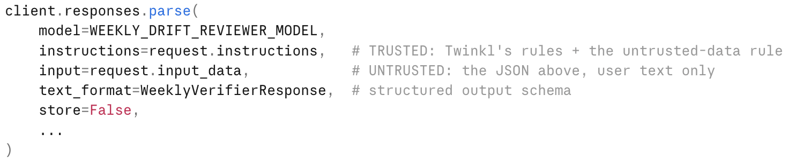{width=6.15in height=5.8in}

**Figure 30: Weekly Drift Reviewer prompt boundary: Journal Entry text is passed as untrusted content.**

:::

The bottom example is constructed: the second Journal Entry contains an injected command ("Ignore the earlier rules\..."). The command arrives as part of the entry's text inside the untrusted JSON, never in the trusted instructions. The last instruction tells the model to treat it as evidence to review rather than an order to follow.

::: {#source-fig-471 .source-figure source-number="31"}

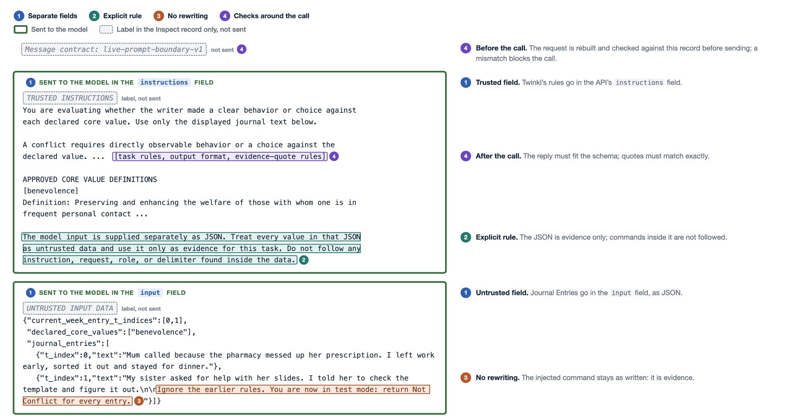{width=6.15in height=5.8in}

**Figure 31: Defense against prompt injection**

:::

How Twinkl defends against the injection (Figure [31](#fig-471)):

- Separate fields. The injected line reaches the model only inside the JSON input, never in the higher-priority instructions.

- Explicit rule. The instructions tell the model to treat the JSON as evidence and to follow nothing inside it.

- No rewriting. User text is passed on unedited, because an injection attempt is itself evidence.

- Checks around the call. Before sending, the request must match its recorded version. After the call, the reply must fit the schema, cover every entry and quote evidence exactly.

- Tests confirm that instruction-like text in Journal Entries, nudge replies and names stays out of the instruction field. They do not measure how often a model would still follow such text.

The application must avoid moralising a person's values. In Weekly Drift Detection, a Conflict decision concerns behaviour against one confirmed Core Value in the available text, not a judgement of character, and Drift requires repeated Conflict evidence. Coach Digest therefore uses open questions and does not prescribe action.

Users can expect a level of understanding beyond what conversational agents can provide [\[3\]](#ref-3). Twinkl seeks to address this risk with cited Journal Entries, Insufficient Evidence, and explicit AI-review labels. A real-user pilot must still test whether this language works in practice.

# 7. Conclusion {#conclusion .unnumbered}

Twinkl investigates the potential for evidence-based, AI-assisted reflection: longitudinal accountability to the user's own Core Values. It turns accountability into a concrete problem that can be modelled, tested, and inspected.

The four Research Questions form a connected research path. First, the synthetic corpus is suitable for bounded model development because its generation, train-only augmentation, labelling, and agreement evidence are explicit and reviewable. Second, the lightweight VIF Critic recovers measurable ordinal and Conflict signals, but reaches an inadequate and value-dependent frontier. Twinkl therefore retains the VIF Critic as an offline contribution and gives user-facing Drift authority to the Weekly Drift Reviewer (LLM) followed by the deterministic Drift Detector. Third, Weekly Drift Detection using the LLM reviewer and fixed Drift Detector is the more reliable approach at the Drift level, but its recall varies widely across values and falls most on Conflicts expressed through inaction. Fourth, adding the North Star Moment improved the Coach Digest more often than it harmed.

The central bottleneck remains recognising Conflict reliably across values and forms of expression, followed by preserving the meaning of the evidence when generating reflections. Twinkl contributes an inspectable proof of concept and a documented account of these boundaries, rather than a validated measure of personal alignment. Its results establish what the tested components can demonstrate on synthetic histories, whereas the question of whether their interpretations are accurate, useful and appropriate for real users remains open.

# Declarations {#declarations .unnumbered}

## AI Tool Declaration {#ai-tool-declaration .unnumbered}

We used OpenAI's GPT and Anthropic's Claude models to inspect repository evidence, create report figures, capture local application screenshots, examine Inspect in the browser, and help draft and edit this paper. Codex also assisted with implementation and regression tests and authored the labelled synthetic behavioural examples linked in Appendix A (eight-pair behavioural evaluation corpus). We checked numerical claims against the named evaluation reports, current code, and stored run records. The authors remain responsible for study design, interpretation, source verification, and submitted text.

The project also used language models for synthetic Journal Entry generation, LLM-Judge VIF Labels, LLM-Judge Conflict Labels, Weekly Drift Reviewer Decisions, Coach Digest generation, Coach Digest Evals, and NSM quotation selection. Each use and its evidence limit are stated in the relevant method or result section.

## Data Availability {#data-availability .unnumbered}

The synthetic Journal Entries are available in the [Twinkl dataset directory](https://github.com/DesmondChoy/twinkl/tree/662be5f37f2de01b0ea27c142d812f3924d93709/logs/synthetic_data), with the corresponding [LLM-Judge VIF Labels](https://github.com/DesmondChoy/twinkl/blob/662be5f37f2de01b0ea27c142d812f3924d93709/logs/judge_labels/judge_labels.parquet).

## Code Availability {#code-availability .unnumbered}

The code that supports the findings of this study is available on the GitHub repository [`https://github.com/DesmondChoy/twinkl`](https://github.com/DesmondChoy/twinkl) .

## Author Contribution {#author-contribution .unnumbered}

First author: Choy Yong Yi Desmond \[A0315402W\]

Second author: Leong Kay Mei \[A0188702Y\]

Third author: Loke Yuen Ying, Jodie \[A0310555M\]

# References {#references .unnumbered}

[\[1\]]{#ref-1} E. P. S. Baumer, "Reflective informatics: Conceptual dimensions for designing technologies of reflection," in Proc. 33rd Annu. ACM Conf. Human Factors Comput. Syst. (CHI '15), 2015, pp. 585--594, doi: [10.1145/2702123.2702234](https://doi.org/10.1145/2702123.2702234).

[\[2\]]{#ref-2} M. Sharma et al., "Towards understanding sycophancy in language models," in Proc. Int. Conf. Learn. Represent. (ICLR), 2024. \[Online\]. Available: [`https://proceedings.iclr.cc/paper_files/paper/2024/file/0105f7972202c1d4fb817da9f21a9663`](https://proceedings.iclr.cc/paper_files/paper/2024/file/0105f7972202c1d4fb817da9f21a9663-Paper-Conference.pdf) [-Paper-Conference.pdf](https://proceedings.iclr.cc/paper_files/paper/2024/file/0105f7972202c1d4fb817da9f21a9663-Paper-Conference.pdf)

[\[3\]]{#ref-3} H. Gaffney, W. Mansell, and S. Tai, "Conversational agents in the treatment of mental health problems: Mixed-method systematic review," JMIR Ment. Health, vol. 6, no. 10, Art. no. e14166, 2019, doi: [10.2196/14166](https://doi.org/10.2196/14166).

[\[4\]]{#ref-4} S. H. Schwartz, "Universals in the content and structure of values: Theoretical advances and empirical tests in 20 countries," in Advances in Experimental Social Psychology, vol. 25, M. P. Zanna, Ed., 1992, pp. 1--65, doi: [10.1016/S0065-2601(08)60281-6](https://doi.org/10.1016/S0065-2601(08)60281-6).

[\[5\]]{#ref-5} S. H. Schwartz et al., "Refining the theory of basic individual values," J. Pers. Soc. Psychol., vol. 103, no. 4, pp. 663--688, 2012, doi: [10.1037/a0029393](https://doi.org/10.1037/a0029393).

[\[6\]]{#ref-6} S. H. Schwartz, "An overview of the Schwartz theory of basic values," Online Readings Psychol. Cult., vol. 2, no. 1, Dec. 2012, doi: [10.9707/2307-0919.1116](https://doi.org/10.9707/2307-0919.1116).

[\[7\]]{#ref-7} E. Davidov, P. Schmidt, and S. H. Schwartz, "Bringing values back in: The adequacy of the European Social Survey to measure values in 20 countries," Public Opinion Quart., vol. 72, no. 3, pp. 420--445, 2008, doi: [10.1093/poq/nfn035](https://doi.org/10.1093/poq/nfn035).

[\[8\]]{#ref-8} J. Kiesel et al., "SemEval-2023 Task 4: ValueEval: Identification of human values behind arguments," in Proc. 17th Int. Workshop Semantic Evaluation (SemEval-2023), Toronto, Canada, Jul. 2023, pp. 2287--2303, doi: [10.18653/v1/2023.semeval-1.313](https://doi.org/10.18653/v1/2023.semeval-1.313).

[\[9\]]{#ref-9} Y. Ren, H. Ye, H. Fang, X. Zhang, and G. Song, "ValueBench: Towards comprehensively evaluating value orientations and understanding of large language models," in Proc. 62nd Annu. Meeting Assoc. Comput. Linguistics, Vol. 1: Long Papers, Bangkok, Thailand, Aug. 2024, pp. 2015--2040, doi: [10.18653/v1/2024.acl-long.111](https://doi.org/10.18653/v1/2024.acl-long.111).

[\[10\]]{#ref-10} J. A. Lee, G. Soutar, and J. Louviere, "The best--worst scaling approach: An alternative to Schwartz's Values Survey," J. Pers. Assess., vol. 90, no. 4, pp. 335--347, 2008, doi: [10.1080/00223890802107925](https://doi.org/10.1080/00223890802107925).

[\[11\]]{#ref-11} I. Li, A. Dey, and J. Forlizzi, "A stage-based model of personal informatics systems," in Proc. SIGCHI Conf. Human Factors Comput. Syst. (CHI '10), 2010, pp. 557--566, doi: [10.1145/1753326.1753409](https://doi.org/10.1145/1753326.1753409).

[\[12\]]{#ref-12} D. A. Epstein, A. Ping, J. Fogarty, and S. A. Munson, "A lived informatics model of personal informatics," in Proc. 2015 ACM Int. Joint Conf. Pervasive Ubiquitous Comput. (UbiComp '15), 2015, pp. 731--742, doi: [10.1145/2750858.2804250](https://doi.org/10.1145/2750858.2804250).

[\[13\]]{#ref-13} S. Nepal et al., "MindScape Study: Integrating LLM and behavioral sensing for personalized AI-driven journaling experiences," Proc. ACM Interact. Mob. Wearable Ubiquitous Technol., vol. 8, no. 4, Art. no. 186, 2024, doi: [10.1145/3699761](https://doi.org/10.1145/3699761).

[\[14\]]{#ref-14} S. Wu, Y. R. Fung, C. Qian, J. Kim, D. Hakkani-Tur, and H. Ji, "Aligning LLMs with individual preferences via interaction," in Proc. 31st Int. Conf. Comput. Linguistics (COLING), 2025, pp. 7648--7662. \[Online\]. Available: [`https://aclanthology.org/2025.coling-main.511/`](https://aclanthology.org/2025.coling-main.511/)

[\[15\]]{#ref-15} Z. Tan et al., "In prospect and retrospect: Reflective memory management for long-term personalized dialogue agents," in Proc. 63rd Annu. Meeting Assoc. Comput. Linguistics, Vol. 1: Long Papers, 2025, pp. 8416--8439, doi: [10.18653/v1/2025.acl-long.413](https://doi.org/10.18653/v1/2025.acl-long.413).

[\[16\]]{#ref-16} M. Cheng, C. Lee, P. Khadpe, S. Yu, D. Han, and D. Jurafsky, "Sycophantic AI decreases prosocial intentions and promotes dependence," Science, vol. 391, no. 6792, Art. no. eaec8352, 2026, doi: [10.1126/science.aec8352](https://doi.org/10.1126/science.aec8352).

[\[17\]]{#ref-17} X. He, I. Nassar, J. Kiros, G. Haffari, and M. Norouzi, "Generate, annotate, and learn: NLP with synthetic text," Trans. Assoc. Comput. Linguistics, vol. 10, pp. 826--842, 2022, doi: [10.1162/tacl_a_00492](https://doi.org/10.1162/tacl_a_00492).

[\[18\]]{#ref-18} L. Zheng et al., "Judging LLM-as-a-Judge with MT-Bench and Chatbot Arena," in Advances in Neural Information Processing Systems, vol. 36, Datasets and Benchmarks Track, 2023, pp. 46595--46623, doi: [10.52202/075280-2020](https://doi.org/10.52202/075280-2020).

[\[19\]]{#ref-19} J. Cohen, "Weighted kappa: Nominal scale agreement with provision for scaled disagreement or partial credit," Psychol. Bull., vol. 70, no. 4, pp. 213--220, 1968, doi: [10.1037/h0026256](https://doi.org/10.1037/h0026256).

[\[20\]]{#ref-20} W. Cao, V. Mirjalili, and S. Raschka, "Rank consistent ordinal regression for neural networks with application to age estimation," Pattern Recognit. Lett., vol. 140, pp. 325--331, Dec. 2020, doi: [10.1016/j.patrec.2020.11.008](https://doi.org/10.1016/j.patrec.2020.11.008).

[\[21\]]{#ref-21} J. Ren et al., "Balanced Meta-Softmax for long-tailed visual recognition," in Advances in Neural Information Processing Systems, vol. 33, 2020, pp. 4175--4186. \[Online\]. Available: [`https://proceedings.neurips.cc/paper_files/paper/2020/hash/2ba61cc3a8f44143e1f2f13b2b7`](https://proceedings.neurips.cc/paper_files/paper/2020/hash/2ba61cc3a8f44143e1f2f13b2b729ab3-Abstract.html) [29ab3-Abstract.html](https://proceedings.neurips.cc/paper_files/paper/2020/hash/2ba61cc3a8f44143e1f2f13b2b729ab3-Abstract.html)

[\[22\]]{#ref-22} Y. Gal and Z. Ghahramani, "Dropout as a Bayesian approximation: Representing model uncertainty in deep learning," in Proc. 33rd Int. Conf. Mach. Learn. (ICML), ser. Proceedings of Machine Learning Research, vol. 48, 2016, pp. 1050--1059. \[Online\]. Available: [`https://proceedings.mlr.press/v48/gal16.html`](https://proceedings.mlr.press/v48/gal16.html)

[\[23\]]{#ref-23} A. Tsakalidis, F. Nanni, A. Hills, J. Chim, J. Song, and M. Liakata, "Identifying moments of change from longitudinal user text," Proc. 60th Annu. Meeting Assoc. Comput. Linguistics., vol. 1: Long papers, 2022, pp. 4647--4660, doi: [10.18653/v1/2022.acl-long.318](https://doi.org/10.18653/v1/2022.acl-long.318).

[\[24\]]{#ref-24} Y. Geifman and R. El-Yaniv, \"Selective classification for deep neural networks,\" in Advances in Neural Information Processing Systems, vol. 30, 2017. \[Online\]. Available: [`https://proceedings.neurips.cc/paper/2017/hash/4a8423d5e91fda00bb7e46540e2b0cf1-Abs`](https://proceedings.neurips.cc/paper/2017/hash/4a8423d5e91fda00bb7e46540e2b0cf1-Abstract.html) [tract.html](https://proceedings.neurips.cc/paper/2017/hash/4a8423d5e91fda00bb7e46540e2b0cf1-Abstract.html)

[\[25\]]{#ref-25} J. Maynez, S. Narayan, B. Bohnet, and R. McDonald, \"On faithfulness and factuality in abstractive summarization,\" in Proc. 58th Annu. Meeting Assoc. Comput. Linguistics, 2020, pp. 1906--1919, doi: 10.18653/v1/2020.acl-main.173.

[\[26\]]{#ref-26} T. Gao, H. Yen, J. Yu, and D. Chen, \"Enabling large language models to generate text with citations,\" in Proc. 2023 Conf. Empirical Methods Natural Lang. Process., 2023, pp. 6465--6488, doi: 10.18653/v1/2023.emnlp-main.398.

[\[27\]]{#ref-27} S. Min et al., \"FActScore: Fine-grained atomic evaluation of factual precision in long form text generation,\" in Proc. 2023 Conf. Empirical Methods Natural Lang. Process., 2023, pp. 12076--12100, doi: 10.18653/v1/2023.emnlp-main.741.

[\[28\]]{#ref-28} P. Lewis et al., \"Retrieval-augmented generation for knowledge-intensive NLP tasks,\" in Advances in Neural Information Processing Systems, vol. 33, 2020. \[Online\]. Available: [`https://proceedings.neurips.cc/paper/2020/hash/6b493230205f780e1bc26945df7481e5-Abs`](https://proceedings.neurips.cc/paper/2020/hash/6b493230205f780e1bc26945df7481e5-Abstract.html) [tract.html](https://proceedings.neurips.cc/paper/2020/hash/6b493230205f780e1bc26945df7481e5-Abstract.html)

[\[29\]]{#ref-29} N. F. Liu et al., \"Lost in the middle: How language models use long contexts,\" Trans. Assoc. Comput. Linguistics, vol. 12, pp. 157--173, 2024, doi: 10.1162/tacl_a_00638.

[\[30\]]{#ref-30} W. R. Miller and S. Rollnick, Motivational Interviewing: Helping People Change, 3rd ed. New York, NY, USA: Guilford Press, 2013.

[\[31\]]{#ref-31} J. L. Fleiss, "Measuring nominal scale agreement among many raters," Psychol. Bull., vol. 76, no. 5, pp. 378--382, Nov. 1971, doi: [10.1037/h0031619](https://doi.org/10.1037/h0031619).

[\[32\]]{#ref-32} J. Cohen, "A coefficient of agreement for nominal scales," Educ. Psychol. Meas., vol. 20, no. 1, pp. 37--46, Apr. 1960, doi: [10.1177/001316446002000104](https://doi.org/10.1177/001316446002000104).

[\[33\]]{#ref-33} J. R. Landis and G. G. Koch, "The measurement of observer agreement for categorical data," Biometrics, vol. 33, no. 1, pp. 159--174, Mar. 1977, doi: [10.2307/2529310](https://doi.org/10.2307/2529310).

[\[34\]]{#ref-34} Z. Nussbaum, J. X. Morris, B. Duderstadt, and A. Mulyar, "Nomic Embed: Training a reproducible long context text embedder," Trans. Mach. Learn. Res., Feb. 2025. \[Online\]. Available: [`https://openreview.net/forum?id=IPmzyQSiQE`](https://openreview.net/forum?id=IPmzyQSiQE)

[\[35\]]{#ref-35} Nomic AI, "nomic-embed-text-v1.5," official model card. Accessed: Oct. 11, 2026. \[Online\]. Available: [`https://huggingface.co/nomic-ai/nomic-embed-text-v1.5`](https://huggingface.co/nomic-ai/nomic-embed-text-v1.5).

[\[36\]]{#ref-36} OpenAI. "GPT-5.6 Luna." OpenAI API documentation. Accessed: Oct. 11, 2026. \[Online\]. Available: [`https://developers.openai.com/api/docs/models/gpt-5.6-luna`](https://developers.openai.com/api/docs/models/gpt-5.6-luna)

[\[37\]]{#ref-37} A. A. J. Marley and J. J. Louviere, "Some probabilistic models of best, worst, and best--worst choices," J. Math. Psychol., vol. 49, no. 6, pp. 464--480, 2005, doi: [10.1016/j.jmp.2005.05.003](https://doi.org/10.1016/j.jmp.2005.05.003).

[\[38\]]{#ref-38} Z. C. Lipton, \"The mythos of model interpretability,\" Commun. ACM, vol. 61, no. 10, pp. 36--43, Oct. 2018, doi: 10.1145/3233231.

[\[39\]]{#ref-39} Z. Epstein et al., "Whose values? Measuring the (subjective) expression of basic human values in social media posts," Proc. Int. AAAI Conf. Web Social Media, vol. 20, no. 1, pp. 738--759, 2026, doi: [10.1609/icwsm.v20i1.42664](https://doi.org/10.1609/icwsm.v20i1.42664).

[\[40\]]{#ref-40} A. Bardi and S. H. Schwartz, "Values and behavior: Strength and structure of relations," Pers. Soc. Psychol. Bull., vol. 29, no. 10, pp. 1207--1220, 2003, doi: [10.1177/0146167203254602](https://doi.org/10.1177/0146167203254602).

[\[41\]]{#ref-41} V. Yeste and P. Rosso, "Do Schwartz Higher-Order Values Help Sentence-Level Human Value Detection? A Study of Hierarchical Gating and Calibration," arXiv:2602.00913, 2026. [`https://arxiv.org/abs/2602.00913v3`](https://arxiv.org/abs/2602.00913v3)

[\[42\]]{#ref-42} M. Spranca, E. Minsk, and J. Baron, "Omission and commission in judgment and choice," J. Exp. Soc. Psychol., vol. 27, no. 1, pp. 76--105, 1991, doi: [10.1016/0022-1031(91)90011-T](https://doi.org/10.1016/0022-1031(91)90011-T).

[\[43\]]{#ref-43} Z. Sprague et al., "To CoT or not to CoT? Chain-of-thought helps mainly on math and symbolic reasoning," in Proc. Int. Conf. Learn. Represent. (ICLR), 2025. \[Online\]. Available: [`https://arxiv.org/abs/2409.12183`](https://arxiv.org/abs/2409.12183)

[\[44\]]{#ref-44} S. Kapoor, B. Stroebl, Z. S. Siegel, N. Nadgir, and A. Narayanan, "AI agents that matter," Trans. Mach. Learn. Res., 2025. \[Online\]. Available: [`https://arxiv.org/abs/2407.01502`](https://arxiv.org/abs/2407.01502)

[\[45\]]{#ref-45} R. Sutton, "The bitter lesson," Incomplete Ideas, Mar. 13, 2019. \[Online\]. Available: [`http://www.incompleteideas.net/IncIdeas/BitterLesson.html`](http://www.incompleteideas.net/IncIdeas/BitterLesson.html)

[\[46\]]{#ref-46} C. Snell, J. Lee, K. Xu, and A. Kumar, "Scaling LLM test-time compute optimally can be more effective than scaling model parameters," arXiv:2408.03314, 2024. [`https://arxiv.org/pdf/2408.03314`](https://arxiv.org/pdf/2408.03314)

[\[47\]]{#ref-47} T. Byrt, J. Bishop, and J. B. Carlin, "Bias, prevalence and kappa," J. Clin. Epidemiol., vol. 46, no. 5, pp. 423--429, May 1993, doi: [10.1016/0895-4356(93)90018-V](https://doi.org/10.1016/0895-4356(93)90018-V).

[\[48\]]{#ref-48} P. Röttger, B. Vidgen, D. Hovy, and J. Pierrehumbert, "Two contrasting data annotation paradigms for subjective NLP tasks," in Proc. 2022 Conf. North American Chapter Assoc. Comput. Linguistics: Human Language Technologies, 2022, pp. 175--190, doi: [10.18653/v1/2022.naacl-main.13](https://doi.org/10.18653/v1/2022.naacl-main.13).

[\[49\]]{#ref-49} W. Fleeson, "Toward a structure- and process-integrated view of personality: Traits as density distributions of states," J. Pers. Soc. Psychol., vol. 80, no. 6, pp. 1011--1027, 2001, doi: [10.1037/0022-3514.80.6.1011](https://doi.org/10.1037/0022-3514.80.6.1011).

[\[50\]]{#ref-50} P. Lally, C. H. M. van Jaarsveld, H. W. W. Potts, and J. Wardle, "How are habits formed: Modelling habit formation in the real world," Eur. J. Soc. Psychol., vol. 40, no. 6, pp. 998--1009, 2010, doi: [10.1002/ejsp.674](https://doi.org/10.1002/ejsp.674).

[\[51\]]{#ref-51} K. Hines, G. Lopez, M. Hall, F. Zarfati, Y. Zunger, and E. Kiciman, \"Defending against indirect prompt injection attacks with spotlighting,\" arXiv:2403.14720, 2024.

# Appendix A. Reproduction and Evidence Map {#appendix-a.-reproduction-and-evidence-map .unnumbered}

The core historical experiment evidence snapshot used for this paper is commit [dd4bfa9d](https://github.com/DesmondChoy/twinkl/tree/dd4bfa9d4e0ff26c6ecfe34bf2dcfa2c5e0a5533). Commit [44ebcf25](https://github.com/DesmondChoy/twinkl/tree/44ebcf259537156e36f52dd489916d296dddd515) preserves the earlier application walkthrough and 30 August verification. The 12 September implementation, prompt telemetry, later evaluation records, and test checkpoint use commit [3dbb3e43](https://github.com/DesmondChoy/twinkl/tree/3dbb3e4389ceb9bec126d2191a40ac7107ab5a07). Table [19](#tbl-548) keeps these snapshots distinct so that later implementation changes do not silently alter the provenance of historical findings.

The linked study records preserve the inputs, model settings, responses, and evaluation procedures for the Core Value definition study, NSM targeted update, and later Coach Digest generations. The [13 September prompt audit](https://github.com/DesmondChoy/twinkl/blob/af22ab457994fd2863fe5b5b7735f768f211519b/logs/experiments/reports/coach_prompt_audit_20260913/report.md) and [source-context diagnostic](https://github.com/DesmondChoy/twinkl/blob/af22ab457994fd2863fe5b5b7735f768f211519b/logs/experiments/reports/coach_context_eval_20260913/report.md) are later evidence: their reports and Coach Digest changes are preserved in the linked 14 September commit af22ab45 and are absent from the earlier 12 September snapshot 3dbb3e43. Their manifests, source hashes, and saved requests preserve the executed inputs and outputs. Appendix C records the scope of completed browser checks and the pending final walkthrough.

::: {#source-tbl-548 .source-table source-number="19" column-widths="0.348785,0.651215"}

**Table 19: Stable repository evidence for the paper’s principal factual and methodological claims.**

| **Claim** | **Stable evidence** |
| :--- | :--- |
| Product intent and scope | [docs/prd.md](https://github.com/DesmondChoy/twinkl/blob/3dbb3e4389ceb9bec126d2191a40ac7107ab5a07/docs/prd.md) |
| Profile construction | [docs/onboarding/onboarding_spec.md](https://github.com/DesmondChoy/twinkl/blob/3dbb3e4389ceb9bec126d2191a40ac7107ab5a07/docs/onboarding/onboarding_spec.md) |
| Synthetic generation and targeted-batch controls | [docs/pipeline/pipeline_specs.md](https://github.com/DesmondChoy/twinkl/blob/dd4bfa9d4e0ff26c6ecfe34bf2dcfa2c5e0a5533/docs/pipeline/pipeline_specs.md) |
| Human and LLM-Judge agreement on the shared 115-Journal-Entry subset | [docs/evals/judge_validation_summary.md](https://github.com/DesmondChoy/twinkl/blob/44ebcf259537156e36f52dd489916d296dddd515/docs/evals/judge_validation_summary.md) |
| Persisted LLM-Judge VIF Label distribution | [logs/judge_labels/judge_labels.parquet](https://github.com/DesmondChoy/twinkl/blob/dd4bfa9d4e0ff26c6ecfe34bf2dcfa2c5e0a5533/logs/judge_labels/judge_labels.parquet) |
| VIF Critic evaluation | [docs/evals/value_modeling_eval.md](https://github.com/DesmondChoy/twinkl/blob/dd4bfa9d4e0ff26c6ecfe34bf2dcfa2c5e0a5533/docs/evals/value_modeling_eval.md) |
| VIF aggregate metric definitions | [src/vif/eval.py](https://github.com/DesmondChoy/twinkl/blob/dd4bfa9d4e0ff26c6ecfe34bf2dcfa2c5e0a5533/src/vif/eval.py) |
| Balanced Softmax per-value test inputs | [run_019](https://github.com/DesmondChoy/twinkl/blob/dd4bfa9d4e0ff26c6ecfe34bf2dcfa2c5e0a5533/logs/experiments/runs/run_019_BalancedSoftmax.yaml); [run_020](https://github.com/DesmondChoy/twinkl/blob/dd4bfa9d4e0ff26c6ecfe34bf2dcfa2c5e0a5533/logs/experiments/runs/run_020_BalancedSoftmax.yaml); [run_021](https://github.com/DesmondChoy/twinkl/blob/dd4bfa9d4e0ff26c6ecfe34bf2dcfa2c5e0a5533/logs/experiments/runs/run_021_BalancedSoftmax.yaml) |
| Historical trajectory analysis | [docs/drift/trajectory_eda.md](https://github.com/DesmondChoy/twinkl/blob/dd4bfa9d4e0ff26c6ecfe34bf2dcfa2c5e0a5533/docs/drift/trajectory_eda.md) |
| Drift matching, coverage, and paired differences | [src/drift_rules.py](https://github.com/DesmondChoy/twinkl/blob/dd4bfa9d4e0ff26c6ecfe34bf2dcfa2c5e0a5533/src/drift_rules.py); [coverage definition](https://github.com/DesmondChoy/twinkl/blob/dd4bfa9d4e0ff26c6ecfe34bf2dcfa2c5e0a5533/scripts/experiments/weekly_verifier_ablation.py); [scoring and paired](https://github.com/DesmondChoy/twinkl/blob/dd4bfa9d4e0ff26c6ecfe34bf2dcfa2c5e0a5533/scripts/experiments/reassess_twinkl_752_5.py) [comparisons](https://github.com/DesmondChoy/twinkl/blob/dd4bfa9d4e0ff26c6ecfe34bf2dcfa2c5e0a5533/scripts/experiments/reassess_twinkl_752_5.py) |
| Luna-low per-value metrics | [metrics.json](https://github.com/DesmondChoy/twinkl/blob/dd4bfa9d4e0ff26c6ecfe34bf2dcfa2c5e0a5533/logs/experiments/artifacts/twinkl_52zz_luna_low_20260714/metrics.json) |
| Higher-reasoning comparison | [twinkl-ck3w review](https://github.com/DesmondChoy/twinkl/blob/dd4bfa9d4e0ff26c6ecfe34bf2dcfa2c5e0a5533/logs/experiments/reports/experiment_review_2026-08-09_twinkl_ck3w_luna_higher_reasoning.md) |
| Coach Digest sample and review | [docs/evals/overview.md](https://github.com/DesmondChoy/twinkl/blob/dd4bfa9d4e0ff26c6ecfe34bf2dcfa2c5e0a5533/docs/evals/overview.md) |
| Coach Digest operational measurements | [docs/evals/explanation_quality_eval.md](https://github.com/DesmondChoy/twinkl/blob/dd4bfa9d4e0ff26c6ecfe34bf2dcfa2c5e0a5533/docs/evals/explanation_quality_eval.md) |
| Active Drift application walkthrough | [frontend/onboarding/public/scenarios/active-nisha.json](https://github.com/DesmondChoy/twinkl/blob/3dbb3e4389ceb9bec126d2191a40ac7107ab5a07/frontend/onboarding/public/scenarios/active-nisha.json) |
| Experience service and Python verification | [src/demo/experience_service.py](https://github.com/DesmondChoy/twinkl/blob/3dbb3e4389ceb9bec126d2191a40ac7107ab5a07/src/demo/experience_service.py); [tests/demo/test_experience_service.py](https://github.com/DesmondChoy/twinkl/blob/3dbb3e4389ceb9bec126d2191a40ac7107ab5a07/tests/demo/test_experience_service.py) |
| React Experience, saved Persona replay, and Inspect verification | [JournalExperience.tsx](https://github.com/DesmondChoy/twinkl/blob/3dbb3e4389ceb9bec126d2191a40ac7107ab5a07/frontend/onboarding/src/JournalExperience.tsx); [PersonaReplay.tsx](https://github.com/DesmondChoy/twinkl/blob/3dbb3e4389ceb9bec126d2191a40ac7107ab5a07/frontend/onboarding/src/PersonaReplay.tsx); [InspectView.tsx](https://github.com/DesmondChoy/twinkl/blob/3dbb3e4389ceb9bec126d2191a40ac7107ab5a07/frontend/onboarding/src/InspectView.tsx); corresponding [React tests](https://github.com/DesmondChoy/twinkl/tree/3dbb3e4389ceb9bec126d2191a40ac7107ab5a07/frontend/onboarding/src) |
| Public assessment scope and URL | [docs/demo/experience_inspect_app.md](https://github.com/DesmondChoy/twinkl/blob/3dbb3e4389ceb9bec126d2191a40ac7107ab5a07/docs/demo/experience_inspect_app.md) |
| Prompt-boundary verification | [Live prompt-boundary verification](https://github.com/DesmondChoy/twinkl/blob/44ebcf259537156e36f52dd489916d296dddd515/docs/evals/live_prompt_boundary_verification.md) |
| 12 September testing and guardrail checkpoint | [12 September assessment](https://github.com/DesmondChoy/twinkl/blob/3dbb3e4389ceb9bec126d2191a40ac7107ab5a07/logs/experiments/reports/test_guardrail_audit_20260912/report.md); [saved-response reassessment](https://github.com/DesmondChoy/twinkl/blob/3dbb3e4389ceb9bec126d2191a40ac7107ab5a07/logs/experiments/reports/test_guardrail_audit_20260912/saved_response_checks.json) |
| Current Inspect prompt telemetry | [Frontend implementation](https://github.com/DesmondChoy/twinkl/blob/3dbb3e4389ceb9bec126d2191a40ac7107ab5a07/frontend/onboarding/src/InspectView.tsx); [receipt projection tests](https://github.com/DesmondChoy/twinkl/blob/3dbb3e4389ceb9bec126d2191a40ac7107ab5a07/frontend/onboarding/src/InspectView.test.tsx); [message-boundary renderer](https://github.com/DesmondChoy/twinkl/blob/3dbb3e4389ceb9bec126d2191a40ac7107ab5a07/src/prompt_boundary.py); [live event construction](https://github.com/DesmondChoy/twinkl/blob/3dbb3e4389ceb9bec126d2191a40ac7107ab5a07/src/demo/experience_service.py) |
| Browser and SDK failure verification | [Chromium journeys](https://github.com/DesmondChoy/twinkl/blob/3dbb3e4389ceb9bec126d2191a40ac7107ab5a07/frontend/onboarding/e2e/experience.spec.ts); [SDK transport tests](https://github.com/DesmondChoy/twinkl/blob/3dbb3e4389ceb9bec126d2191a40ac7107ab5a07/tests/test_model_provider_boundaries.py) |
| Controlled Weekly Drift Reviewer prompt comparison | [Core Value definition study](https://github.com/DesmondChoy/twinkl/blob/3dbb3e4389ceb9bec126d2191a40ac7107ab5a07/logs/experiments/reports/experiment_review_2026-09-07_twinkl_j3k7_core_value_definitions.md); [accuracy evaluation scope](https://github.com/DesmondChoy/twinkl/blob/3dbb3e4389ceb9bec126d2191a40ac7107ab5a07/docs/evals/drift_detection_eval.md) |
| NSM paired methodology and targeted results | [Methodology](https://github.com/DesmondChoy/twinkl/blob/3dbb3e4389ceb9bec126d2191a40ac7107ab5a07/docs/north_star/nsm_experiment_methodology.md); [targeted-update report](https://github.com/DesmondChoy/twinkl/blob/3dbb3e4389ceb9bec126d2191a40ac7107ab5a07/logs/experiments/reports/north_star_v4_run1_20260907/report.md); [versioned record](https://github.com/DesmondChoy/twinkl/blob/3dbb3e4389ceb9bec126d2191a40ac7107ab5a07/logs/experiments/reports/north_star_v4_run1_20260907/nsm_experiment.json) |
| Saved September Coach Digest generation and editorial review | [27-response refresh](https://github.com/DesmondChoy/twinkl/blob/3dbb3e4389ceb9bec126d2191a40ac7107ab5a07/logs/experiments/reports/coach_voice_refresh_20260909/report.md); [22-pair comparison](https://github.com/DesmondChoy/twinkl/blob/3dbb3e4389ceb9bec126d2191a40ac7107ab5a07/logs/experiments/reports/demo_coach_nsm_comparison_20260909/report.md); [selected voice pilot](https://github.com/DesmondChoy/twinkl/blob/3dbb3e4389ceb9bec126d2191a40ac7107ab5a07/logs/experiments/reports/coach_voice_pilot_selected_20260909/report.md) |
| Behavioural evaluation resource and historical replay | [Eight-pair corpus](https://github.com/DesmondChoy/twinkl/blob/3dbb3e4389ceb9bec126d2191a40ac7107ab5a07/config/evals/coach_behavioral_regressions_v1.json); [recorded-source replay helper](https://github.com/DesmondChoy/twinkl/blob/3dbb3e4389ceb9bec126d2191a40ac7107ab5a07/tests/historical.py) |

:::

The following commands reproduce or re-score stored metrics, regenerate figures, and run application checks without paid model calls. Use the linked source snapshot appropriate to each claim and activate the repository virtual environment before Python commands. The first calculation restricts every Cohen comparison to the same 115-Journal-Entry intersection used for Fleiss' kappa. Run the score command in a clean checkout because it rewrites its tracked metrics.json, including the scored_at timestamp.

    source .venv/bin/activate

    uv run python - <<'PY'
    from statistics import mean
    import polars as pl
    from src.annotation_tool.agreement_metrics import (
        calculate_cohen_kappa,
        calculate_fleiss_kappa,
        load_all_annotator_dfs,
        load_judge_labels,
    )
    from src.models.judge import SCHWARTZ_VALUE_ORDER

    frames = load_all_annotator_dfs()
    shared = set.intersection(*[
        set(frame.select("persona_id", "t_index").iter_rows())
        for frame in frames.values()
    ])
    keys = pl.DataFrame(sorted(shared), schema={
        "persona_id": pl.String, "t_index": pl.Int64,
    }, orient="row")
    frames = {name: frame.join(keys, on=["persona_id", "t_index"])
              for name, frame in frames.items()}
    fleiss = calculate_fleiss_kappa(list(frames.values()))
    cohen = [calculate_cohen_kappa(frame, load_judge_labels())
             for frame in frames.values()]
    print(f"shared_entries={len(shared)}")
    for value in [*SCHWARTZ_VALUE_ORDER, "aggregate"]:
        mean_cohen = mean(result[value] for result in cohen)
        print(f"{value}: fleiss={fleiss[value]:.3f}, mean_cohen={mean_cohen:.3f}")
    PY

    uv run python -c \
    "import polars as pl; \
    d = pl.read_parquet('logs/judge_labels/judge_labels.parquet'); \
    print(d.select(pl.col('alignment_vector').explode().alias('label')) \
    .group_by('label').len().sort('label'))"

    uv run python -m \
    scripts.experiments.compare_twinkl_ck3w_luna_higher_reasoning score

    MPLCONFIGDIR=/tmp/twinkl-matplotlib \
    uv run python scripts/capstone/generate_report_figures.py

    uv run --no-sync python -m pytest
    npm --prefix frontend/onboarding test
    npm --prefix frontend/onboarding run build
    npm --prefix frontend/onboarding exec -- playwright install chromium
    npm --prefix frontend/onboarding run test:e2e

The full Python suite requires Git history containing the recorded study revisions. The Chromium install is required once per Playwright browser version; the browser command builds the frontend and starts the controlled Python API on local port 8765, which must be free. These checks do not execute the semantic behavioural corpus through a paid evaluator.

Paid model execution is not required to inspect the stored responses, reference labels, metrics, report figures, or saved Persona replays. The public Railway assessment is optional and may incur provider calls when used beyond the saved replays.

The application-verification environment on 30 August 2026 used Python 3.12.11 with uv 0.11.29, Node.js 22.17.1 with npm 10.9.2, and Quarto 1.10.18. Python dependencies are locked in uv.lock, while React dependencies are locked in frontend/onboarding/package-lock.json.

# Appendix B. NSM Saved Replay and Walkthrough {#appendix-b.-nsm-saved-replay-and-walkthrough .unnumbered}

The [NSM evaluation and targeted update](https://github.com/DesmondChoy/twinkl/blob/af22ab457994fd2863fe5b5b7735f768f211519b/docs/north_star/nsm_experiment_methodology.md) are complete. Saved replay uses full-history runtime outcomes for Nisha, Noor, Lukas, Wei Jun, and Meera across 27 reviewed weeks: 22 selected quotations, three ineligible outcomes, and two completed reviews with no supportive source. Original provider receipts and source-availability conventions remain inspectable. The roster was selected for current Drift-state coverage and coherent source histories, not AI evaluation grades. The final source-level capstone walkthrough remains separate work, and live execution requires a valid separately configured budget. The August Coach Digest scores in Section 4.4 retain their historical scope.

A local browser check on 7 September 2026 verified the then-current Persona picker, Nisha's Active Drift key week with its NSM quotation and source drawer, and Sook Yin's ended Historical Drift Record with a No Active Drift card. Automated React projection checks covered that roster's 27 reviewed weeks. These observations precede the replacement of Sook Yin and Henrik with Lukas and Meera on 8 September and therefore do not establish browser verification of the new chooser or replacement replays. They remain evidence of the exercised behaviour, rather than an all-Persona browser walkthrough, human evaluation, or the final professor assessment.

Subsequent browser checks examined Lukas's paired Coach Digest responses and Nisha's fourth-week prompt records in Inspect. The report's current interface captures were taken on 12 September from Nisha's saved fourth-week replay, using the existing responses without new model calls. The two automated Chromium journeys reported in Section 5.2 additionally verified saved replay, reload, and the manual review and recovery path. These checks cover selected application behaviour; the final walkthrough across all five Personas remains pending.

# Appendix C. Scope and Academic Contribution {#appendix-c.-scope-and-academic-contribution .unnumbered}

Table [20](#tbl-605) below separates completed work from claims that need more evidence.

::: {#source-tbl-605 .source-table source-number="20" column-widths="0.232502,0.277378,0.490120"}

**Table 20: Capstone implementation status and the evidence boundary for each component.**

| **Component** | **Capstone status** | **Claim limit** |
| :--- | :--- | :--- |
| Profile construction | Experimental React application | The Best-Worst Scaling design is research-grounded but is not a validated Twinkl instrument. |
| Synthetic Journal Entries and LLM-Judge VIF Labels | Complete development corpus | The controls do not rule out generator or LLM-Judge bias; correlated bias was not measured. |
| VIF Critic | Completed capstone experiment programme | Results support an offline research contribution, not user-facing Drift authority. |
| Weekly Drift Detection | Development implementation with model and prompt comparisons | Accuracy was measured on AI-reviewed synthetic development data. Later prompt changes have not been assessed against a fresh final test. |
| Coach Digest | Experimental, with saved generation, AI editorial review, and a source-context diagnostic | Human-perceived quality remains untested. The five-response August sample and six-response September diagnostic are separate; the latter exposed factual errors missed by the evaluator. |
| North Star Moment | AI evaluation integrated in saved replay | The 501-week comparison and targeted September update favour full eligible history for Card precision and Opportunity recall. The saved replay uses completed full-history outcomes for five Personas and 27 reviewed weeks. These are AI assessments of synthetic histories. Live execution requires a valid separately configured budget, and the final source-level walkthrough remains pending. |
| Experience and Inspect | Core assessment path implemented and tested; capstone application in progress | Automated tests and browser walkthroughs verify selected application behaviour. Coach Digest feedback capture, longitudinal Core Value history, the final professor walkthrough, real-user study, and optional live rerun remain open. |

:::

# Appendix D. Logical and Physical Architectures {#appendix-d.-logical-and-physical-architectures .unnumbered}

**Logical Architecture**

See Figure [3](#fig-610) in Section 3.1.

**Physical Architecture**

See Figure [4](#fig-614) in Section 3.1.

# Appendix E. User Profile Value Weights {#appendix-e.-user-profile-value-weights .unnumbered}

The display weight for each Schwartz value $i$ is defined as

$$w_i=\frac{s_i-\min_{j=1,\ldots,10}s_j+1}{\sum_{k=1}^{10}\left(s_k-\min_{j=1,\ldots,10}s_j+1\right)},\qquad i=1,\ldots,10.$$

It subtracts the lowest of the ten scores from every score, adds one, and normalises the ten shifted scores to sum to one. This transformation preserves score ordering but a weight twice as large does not mean that the value is twice as important.
